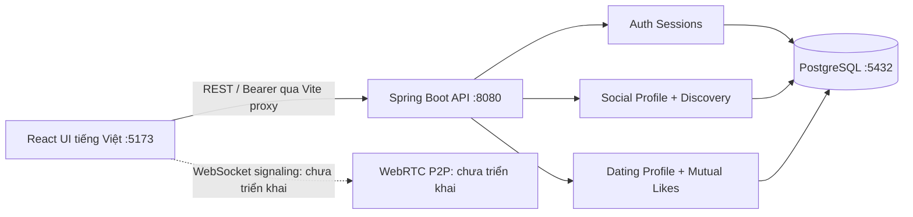
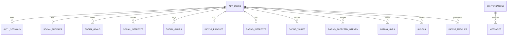

# Nexora Peerly — React + Spring Boot + PostgreSQL

> **Trạng thái hiện tại:** Backend Java 21 / Spring Boot 3.5.16 nằm trong dự án riêng `D:\N3 HK1\Nexora_Backend`, kết nối database `nexora_peerly` tại cổng `5432`. Frontend React tại `frontend/` đã nối API và có giao diện tiếng Việt cho đăng ký/đăng nhập, hồ sơ kết bạn/hẹn hò, khám phá, thích, ghép đôi và chặn. Trang Tin nhắn thông báo chưa khả dụng vì backend chưa có API chat/WebRTC. Xem [hướng dẫn frontend](frontend/README.md), [hướng dẫn backend](../Nexora_Backend/README.md) và [hướng dẫn database](database/README.md).

## Chạy ứng dụng hiện tại

Mở hai terminal:

```powershell
# Terminal 1: backend, cổng 8080
cd "D:\N3 HK1\Nexora_Backend"
.\run.cmd
```

```powershell
# Terminal 2: frontend, cổng 5173
cd "D:\N3 HK1\Nexora Peerly\frontend"
pnpm install
pnpm dev
```

Mở [giao diện Nexora Peerly](http://127.0.0.1:5173), tạo tài khoản rồi hoàn thiện hồ sơ. Vite chuyển request `/api` tới backend cổng `8080`; cấu hình database nằm ở `.env` của dự án backend. Frontend không cần mật khẩu PostgreSQL. Xem [hướng dẫn frontend](frontend/README.md) để kiểm thử, chỉnh URL API và hiểu cách lưu phiên đăng nhập.

## Đặc tả backend/database ban đầu

Nội dung dưới đây được giữ để tham khảo thiết kế ban đầu. Thư mục `backend/` trong repository này chỉ là migration runner; Docker API, `smoke_demo.py` và một số lệnh minh họa trong đặc tả có thể chưa tồn tại ở đây. Khi chạy ứng dụng, dùng các hướng dẫn hiện tại liên kết ở trên.

**Mục đích:** Bộ khung chạy được cho ĐACS4: **Java 21 / Spring Boot 3.5.16 / PostgreSQL 16 / Flyway**. Một tài khoản có Social Mode và Relationship Mode, dùng dữ liệu riêng theo từng mục đích. Đây là demo backend/database, **không phải ứng dụng WebRTC hoàn chỉnh**.

## 1. Kiến trúc



Spring Boot là **modular monolith**, không phải microservices. `conversations` và `messages` hiện chỉ là bảng sẵn sàng cho giai đoạn sau; chưa có API chat hoặc giao thức signaling. Chỉ khi triển khai DataChannel/WebRTC thật và có chứng cứ đường truyền mới gọi tính năng chat P2P đã hoàn thành.

## 2. Cài đặt và chạy trên Windows / Linux / macOS

**Yêu cầu:** Docker Desktop có Compose và Internet để tải image/dependency. Không cần cài Java, Maven hoặc PostgreSQL trên máy nếu chạy bằng Docker.

```bash
# Giải nén và mở terminal tại thư mục nexory-peerly-backend-demo
# Tạo file cấu hình (PowerShell: Copy-Item .env.example .env)
cp .env.example .env
# Tùy chọn chỉnh mật khẩu POSTGRES_PASSWORD trong .env

docker compose up --build -d

docker compose ps
```

- Health: http://localhost:8080/actuator/health -> `{"status":"UP"}`
- PostgreSQL: `localhost:5433`, database `nexory_peerly`, user/password trong `.env`
- API: `http://localhost:8080/api`
- Flyway sẽ tự chạy các file `backend/src/main/resources/db/migration/V1__schema.sql` và `V2__future_media_and_invites.sql` ở lần khởi động đầu tiên.
- Kiểm tra SQL: `docker compose exec postgres psql -U peerly -d nexory_peerly -c '\dt'` (nếu thay biến môi trường user/db, chỉnh tương ứng).
- Theo dõi lỗi: `docker compose logs -f api`
- Tắt: `docker compose down`; **không xóa** PostgreSQL volume.
- Xóa **toàn bộ dữ liệu demo**: `docker compose down -v` (chỉ chạy khi thực sự muốn xóa).

Nếu máy đã có PostgreSQL tại `5433` hoặc ứng dụng ở `8080`, đổi host port phía trái trong `docker-compose.yml`.

Chỉ expose port API/DB lên loopback máy host (`127.0.0.1`), không được dùng cấu hình mật khẩu demo cho server công khai.

## 3. Chạy tự động hai tài khoản + matching + likes

Cần Python 3 (chỉ dùng standard library). Khi API đang chạy:

```bash
python examples/smoke_demo.py
```

Script sẽ:
1. Đăng ký hai tài khoản demo ngẫu nhiên, chỉ dành cho 18+.
2. Tạo hai hồ sơ Social (NEW_FRIENDS, TALK, GAMING) và kiểm tra ghép game `genshin_impact`.
3. Tạo Dating Profile, kiểm tra lọc tuổi & intent hai chiều.
4. Gửi Like A->B, Like B->A và xác nhận tạo Mutual Match.
5. Chặn B từ A và xác nhận B biến mất khỏi đề xuất.
6. Đăng xuất A.

Email mỗi lượt chạy được tạo mới; script **không sử dụng tài khoản seed có mật khẩu cố định**. Dữ liệu vẫn ở PostgreSQL cho đến khi xóa volume.

## 4. API hiện có

| Method | URL | Chức năng |
|---|---|---|
| GET | `/actuator/health` | Health check (public) |
| POST | `/api/auth/register` | Đăng ký, tạo Bearer token |
| POST | `/api/auth/login` | Đăng nhập |
| POST | `/api/auth/logout` | Thu hồi token hiện tại |
| GET | `/api/me` | Thông tin tài khoản của chính mình |
| GET | `/api/catalog` | Danh mục mã mục đích/sở thích mẫu |
| PUT | `/api/social/profile` | Cập nhật Social Profile, mục đích và game |
| GET | `/api/social/profile` | Xem Social Profile của mình |
| GET | `/api/social/discover?goal=GAMING` | Ghép ứng viên Social có điều kiện và điểm số |
| PUT | `/api/dating/profile` | Dating Profile + cấu hình mục tiêu và quyền hiển thị |
| GET | `/api/dating/profile` | Xem Dating Profile của mình |
| GET | `/api/dating/discover` | Lọc tuổi/intent hai chiều, xếp hạng sở thích/giá trị |
| POST | `/api/dating/likes/{userId}` | Like; tự động tạo match nếu hai chiều |
| GET | `/api/dating/matches` | Xem mutual matches |
| POST | `/api/dating/blocks/{userId}` | Chặn người dùng, hủy likes/matches giữa hai phía |

Ngoại trừ health, register và login, các API đều cần `Authorization: Bearer <accessToken>`. Có ví dụ REST Request trong `examples/api-requests.http`.

### Điểm phân biệt Social và Dating

- **Social:** Một người có thể bật nhiều mục đích `NEW_FRIENDS`, `TALK`, `GAMING`. Người muốn `TALK` phải chọn trạng thái `ready_to_connect=true`; Gaming yêu cầu **trùng ít nhất một game** và nền tảng tương thích. `NEW_FRIENDS` dùng sở thích chung, không phải tìm hẹn hò.
- **Dating:** Tách hoàn toàn khỏi hàng ứng viên Social, yêu cầu hồ sơ Relationship `enabled=true` + `DISCOVERABLE`; tuổi nằm trong khoảng ưu tiên của **cả hai**, và mục tiêu `intent` thuộc danh sách `acceptedIntents` của **cả hai**; sau đó tính điểm `0.5 * Jaccard(interests) + 0.3 * intentSimilarity + 0.2 * Jaccard(values)`.
- Điểm là **điểm xếp hạng thiết kế**, không phải xác suất hẹn hò thành công. Có `reasons` giúp giải thích.
- Trạng thái `readyToConnect` là cờ người dùng tự khai, **chưa phải online presence thực tế**; sau này cần heartbeat WebSocket.

## 5. Sơ đồ database



- Khoá chính người dùng: UUID; nhiều bảng con dùng FK `ON DELETE CASCADE`.
- `birth_date` được lưu kín trên server để tính độ tuổi, API discovery chỉ trả về tuổi, **không trả ngày sinh**.
- Mật khẩu mã hóa với BCrypt; token 256-bit ngẫu nhiên, chỉ lưu SHA-256 hash trong `auth_sessions`, hết hạn sau 7 ngày và có thể revoke.
- Một vài bảng như `conversations`, `messages` là thiết kế ban đầu, chưa kết nối API; `messages` không được gọi là E2EE. WebRTC DTLS cũng không tự làm dữ liệu lưu server trở thành E2EE.
- Đã chuẩn bị **bảng `profile_photos`** để lưu metadata ảnh theo `SOCIAL` / `RELATIONSHIP`, nhưng **chưa có API upload, file storage hay hiển thị ảnh**. Tương tự, bảng `social_invites` mới là cấu trúc dữ liệu, chưa có API accept/reject. Khi bổ sung, lưu ảnh vào object/file storage, kiểm soát quyền truy cập và giới hạn loại/kích thước/nội dung tệp; không lưu ảnh gốc vào bản ghi user.

## 6. Những giới hạn của DEMO cần nêu trong đề cương

**Đã code:** PostgreSQL Flyway migration (bao gồm bảng metadata ảnh và social invite dự phòng), tài khoản, bảo mật Bearer token/Bcrypt, API hồ sơ Social/Dating, phân tách 2 chế độ, lọc hai chiều, scoring, mutual like, block và unit test tính điểm. Frontend React đã nối API và có giao diện tiếng Việt cho các chức năng này; xem [hướng dẫn frontend](frontend/README.md) cho phạm vi và lệnh kiểm thử hiện tại. Script API smoke demo là mục trong đặc tả ban đầu, không phải lệnh chạy của frontend.

**Chưa code:** upload ảnh, P2P signaling WebSocket, STUN/TURN, truyền DataChannel, gửi file, gọi thoại/video, CRUD lịch sử chat, xác minh tuổi/danh tính thực tế, chống lạm dụng quy mô lớn, rate limiting, captcha, kiểm duyệt nội dung ảnh, quy trình báo cáo và xử lý khiếu nại. Đánh dấu rõ các mục này trong hồ sơ bảo vệ.

Trước khi đưa lên mạng thật phải bổ sung TLS/HTTPS, quản lý secret, rate limiting, email verification, kiểm soát quyền riêng tư, phân quyền tối thiểu, audit log phù hợp, kiểm thử bảo mật và compliance. Bản demo **chỉ dành cho môi trường phát triển local**.

## 7. Kiểm thử

Trên máy có Java 21 + Maven + PostgreSQL (hoặc khi DB container đang chạy), chạy:

```bash
cd backend
mvn test
```

Unit test `ScoringTest` là thuần Java. Để chạy toàn app ngoài Docker, cần thiết lập các biến datasource (xem `application.yml`) và khởi chạy PostgreSQL trước.

### Hướng phát triển tiếp theo

1. **Social invitation:** tạo bảng `social_invites`, accept/reject/timeout, chỉ tạo session khi cả hai đồng ý.
2. **WebSocket signaling:** yêu cầu token và xác nhận thành viên session trước khi relay SDP/ICE.
3. **WebRTC:** DataChannel cho chat/file, media tracks cho audio/video, thử nghiệm LAN/khác NAT, TURN fallback có kiểm soát.
4. **Media profile:** upload ảnh có kiểm duyệt, chỉ hiển thị ảnh dating khi được người dùng chủ động bật.
5. **Persistence:** đồng bộ tin nhắn với UUID idempotency, chính sách dữ liệu, xóa lịch sử.

> **Tình trạng xác minh tại thời điểm tạo:** Mã và cấu hình đã được kiểm tra tĩnh, nhưng môi trường tạo artifact không có Docker/Maven nên chưa thể thực hiện build/run integration thực tế. Cần thực hiện `docker compose up --build` và `python examples/smoke_demo.py` trên máy bạn để xác minh end-to-end.
