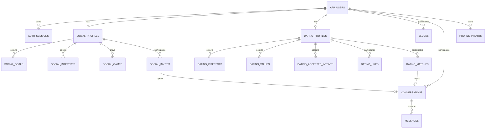

# PostgreSQL cho Nexory Peerly

Đã xây dựng phần database theo README gốc: một tài khoản, dữ liệu Social và Relationship tách riêng; auth session, likes/matches, blocks, hội thoại/tin nhắn, metadata ảnh và Social invite. Backend REST hiện nằm ở `D:\N3 HK1\Nexora_Backend`, dùng database đã đổi tên thành `nexora_peerly` tại cổng `5432`; xem [hướng dẫn backend](../../Nexora_Backend/README.md). Thư mục database này vẫn giữ các script quản lý và migration ban đầu. Các tên `nexory_peerly` bên dưới là thông tin của lần thiết lập trước khi đổi tên; kết nối hiện tại lấy từ `.env`.

## Chạy trên máy Windows hiện tại

Máy có PostgreSQL 18 và Java 21; Docker Desktop cũng đã hoạt động. **Kết nối hiện tại** trong `.env` dùng server PostgreSQL đã có tại `127.0.0.1:5432`, database `nexory_peerly`, username `postgres`. Đã chạy V1–V3 trên database này. Không chạy `init/start/stop` để quản lý server đã có; Windows service PostgreSQL quản lý vòng đời của nó.

Trước đó đã tạo **cluster riêng của dự án** ở `.local/postgres`, cổng `5433`. Cluster này và database cũ `peerly` được giữ nguyên; dữ liệu không tự chuyển giữa các database. Các lệnh `init/start/stop` bên dưới chỉ dành cho cluster riêng khi `.env` trỏ tới cổng `5433` với thông tin đăng nhập của cluster đó.

```powershell
# Chạy tại thư mục gốc repository. Lần đầu tạo .env với hai mật khẩu ngẫu nhiên.
.\scripts\database.ps1 init

# Các lần sau / sau khi khởi động lại máy:
.\scripts\database.ps1 start
.\scripts\database.ps1 check
.\scripts\database.ps1 info
.\scripts\database.ps1 inspect
.\scripts\database.ps1 validate
.\scripts\database.ps1 test
.\scripts\database.ps1 test-concurrency

# Console SQL; thoát bằng \q
.\scripts\database.ps1 psql

# Dừng riêng database của dự án, giữ nguyên dữ liệu:
.\scripts\database.ps1 stop
```

Nếu PostgreSQL được cài nơi khác, truyền `-PgBin 'C:\path\to\PostgreSQL\bin'`. Dùng đúng **major version đã tạo cluster**; không trỏ binary 16 vào cluster 18. Script yêu cầu PostgreSQL 16+ và Java 21, tải Maven 3.9.11 vào `.local/tools` khi thiếu, xác minh SHA-512 rồi chạy Flyway Maven plugin. Lần chạy đầu cần Internet; Maven dependencies lưu trong cache người dùng.

`init` chạy lại không xóa database, không đổi mật khẩu role đã có và không chạy lại migration đã áp dụng. Nếu `.env` bị mất/đổi mật khẩu, cần khôi phục đúng thông tin; script không tự reset thông tin đăng nhập. Không sửa migration đã chạy; thêm migration có số phiên bản tiếp theo rồi chạy `migrate`. Hiện có V1 (schema), V2 (ảnh/invite) và V3 (sửa trigger dùng chung cho likes/matches, phát hiện trong kiểm thử thực tế).

## Thông tin kết nối hiện tại trong pgAdmin / DBeaver

Để dùng server PostgreSQL đã có tại `127.0.0.1:5432`, database `nexory_peerly`, username `postgres`, chạy `./scripts/connect-postgres.ps1` trong PowerShell. Script hỏi mật khẩu bằng ô nhập ẩn, kiểm tra kết nối SQL rồi mới cập nhật `.env`. Cấu hình cũ được sao lưu trong `.local`; script không tạo database, chạy migration hay thay đổi dữ liệu. Nếu database chưa tồn tại hoặc mật khẩu sai, cấu hình dự án được giữ nguyên.

| Mục | Giá trị hiện tại |
|---|---|
| Host | `127.0.0.1` |
| Port | `5432` |
| Database | `nexory_peerly` |
| Username | `postgres` |
| Password | Giá trị `DB_PASSWORD` trong `.env` ở gốc repo |
| JDBC URL | `jdbc:postgresql://127.0.0.1:5432/nexory_peerly` |

`.env` và toàn bộ `.local/` được Git ignore. Không dán mật khẩu vào chat hoặc commit. `peerly_admin` và `peerly` là các role của cluster riêng cổng `5433`; kết nối hiện tại dùng `postgres` theo lựa chọn của người dùng. Khi triển khai production nên tách tài khoản migration và tài khoản runtime ít quyền hơn. Cluster riêng không phải Windows service tự khởi động; chỉ chạy `start` sau khi reboot nếu sử dụng cluster riêng.

## Docker PostgreSQL 16 theo README gốc

Docker Compose giữ **PostgreSQL 16** theo yêu cầu; đường chạy local hiện tại dùng PostgreSQL 18 đã cài sẵn. SQL dùng tính năng có trong PostgreSQL 16+. Chưa coi việc chạy trên 18 là bằng chứng đã chạy Docker/16.

```powershell
# Dừng cluster local trước nếu dùng cùng port 5433.
.\scripts\database.ps1 stop

# Dùng .env đã tạo; nếu chạy trên máy khác, copy .env.example và thay HAI mật khẩu.
docker compose up -d postgres
docker compose run --rm migrate
docker compose run --rm migrate mvn -B -f /workspace/backend/pom.xml flyway:validate
docker compose ps

# psql sẽ hỏi mật khẩu DB_PASSWORD, không đưa mật khẩu vào đối số lệnh:
docker compose exec postgres psql -h 127.0.0.1 -U peerly -d nexory_peerly -W

docker compose down
```

Docker dùng named volume `peerly_postgres`, tách biệt `.local/postgres`. `down` giữ volume; không dùng `down -v` nếu cần giữ dữ liệu. Bootstrap SQL chỉ chạy khi volume mới. Đổi biến password trong `.env` không tự đổi password của database đã tồn tại. Đổi host port bằng `DB_PORT` nếu cần.

## Schema và dữ liệu khởi tạo

| Nhóm | Bảng |
|---|---|
| Tài khoản | `app_users`, `auth_sessions` |
| Danh mục | `interest_catalog`, `social_goal_catalog`, `game_catalog`, `platform_catalog`, `dating_intent_catalog`, `dating_value_catalog` |
| Social | `social_profiles`, `social_goals`, `social_interests`, `social_games` |
| Relationship | `dating_profiles`, `dating_interests`, `dating_values`, `dating_accepted_intents`, `dating_likes`, `dating_matches` |
| Chặn / hội thoại | `blocks`, `conversations`, `messages` |
| Chuẩn bị tương lai | `profile_photos`, `social_invites` |

Tổng cộng **23 bảng nghiệp vụ**, cộng `flyway_schema_history`. Không seed tài khoản có mật khẩu cố định. Catalog có 8 sở thích của frontend, 3 mục đích Social, một số game (gồm `genshin_impact`), platform, intent và giá trị Relationship. Bộ mã intent/values là lựa chọn triển khai mới vì README chưa chốt; frontend/backend phải dùng `/api/catalog` sau này. Metadata game chỉ là dữ liệu mẫu, không thay thế kiểm tra tính tương thích edition/platform thực tế.



## Các quy tắc đã bảo vệ ở database

- UUID tự sinh, timestamp có timezone; session kết nối mặc định UTC. Tính tuổi từ ngày sinh, không lưu một cột tuổi sẽ bị lỗi thời. Check 18+ áp dụng khi ghi; không xác minh tuổi ngoài đời.
- Email unique theo `lower(email)`. Backend vẫn chuẩn hóa/kiểm tra email. Password chỉ nhận **định dạng** hash BCrypt; việc hash/verify nằm ở Spring Security, database không hash mật khẩu hộ API.
- Token chỉ lưu SHA-256 hex 64 ký tự; session mặc định 7 ngày, có revoke. API phải kiểm tra expires/revoked; bản ghi không tự mất khi hết hạn.
- Relationship mặc định `enabled=false`, `visibility=HIDDEN`; chọn sở thích riêng, FK không cho ghi Relationship interests khi chưa có Relationship profile.
- Không self-like/self-block/self-invite. Likes có hướng, matches có cặp canonical `user_a_id < user_b_id` và unique. Match ACTIVE yêu cầu có cả hai lượt thích. API vẫn chịu trách nhiệm **tạo** match khi like trở thành hai chiều.
- Block tự hủy likes hai chiều, chuyển match sang BLOCKED, kết thúc hội thoại đang mở và hủy invite PENDING. Tạo like/match/invite/conversation mới khi đang block bị từ chối. Unblock không tự phục hồi dữ liệu đã hủy.
- Mỗi conversation có đúng hai participant ở hai cột, mode và nguồn khởi tạo hợp lệ. Relationship cần đúng active mutual match; Social cần invite ACCEPTED từ cả hai. Không đổi participant/mode/nguồn sau khi tạo, không mở lại conversation đã kết thúc.
- Message chỉ được ghi bởi một trong hai participant, vào conversation ACTIVE không bị block; tối đa 4.000 ký tự, không rỗng. Unique `(conversation_id, client_message_id)` chống trùng; index `(conversation_id, created_at, id)` hỗ trợ cursor. Lịch sử append-only, không có API sửa tin.
- Profile photo chỉ lưu storage key và metadata, giới hạn khai báo 10 MiB, 10 vị trí mỗi mode và một ảnh primary mỗi mode. API tương lai phải xác minh bytes, loại ảnh thực tế, quyền đọc và moderation; schema không làm việc đó.
- Social invite có hạn 45 giây để khớp demo frontend, không chấp nhận lời mời quá hạn/thiếu hai đồng ý, không hồi sinh lời mời đã kết thúc. Cặp đảo chiều không thể có thêm invite PENDING.

## Contract bắt buộc khi viết backend

1. Lấy user ID từ auth session; không tin `senderId` từ client. Chủ database có thể đọc các bảng; **schema không thay thế authorization theo người dùng và không bật RLS**. Discovery không trả ngày sinh hoặc hash mật khẩu/token.
2. Social: lọc enabled, goal, block hai chiều; TALK kiểm tra ready flag và sau này presence thực; GAMING kiểm tra game và platform/crossplay tương thích. Relationship: kiểm tra enabled/DISCOVERABLE, tuổi và accepted intent **hai chiều**, rồi tính điểm trong service. Database không triển khai scoring/discovery API.
3. Với thay đổi liên quan cặp người dùng, mở transaction và gọi `SELECT lock_user_pair(:a,:b)` **trước khi khóa/sửa match, invite hoặc conversation**. Sau đó đọc lại trạng thái, thực hiện mutation và commit. Các trigger dùng cùng thứ tự user ID. Xử lý retry có giới hạn cho deadlock/serialization failures; không giữ transaction trong khi chờ socket/peer.
4. Khi tạo lời mời trực tiếp, sender mặc định đã đồng ý; khi hệ thống random đưa lời mời tới hai người, phải insert `sender_accepted=false`. Backend chạy job chuyển invite quá hạn thành EXPIRED, giải phóng reservation. Unique theo cặp **không** đảm bảo mỗi người chỉ có một phiên đang hoạt động; reservation/presence còn cần triển khai ở matching service.
5. Khi retry lưu tin, tra `(conversation_id, client_message_id)`, xác nhận cùng sender và body rồi trả bản ghi cũ. Nếu payload khác, trả conflict; không ghi đè. Bản ghi DB chứng minh đã lưu, không chứng minh peer đã nhận. Không gắn nhãn E2EE cho nội dung lưu dạng rõ.
6. Xóa trực tiếp account sẽ cascade xóa dữ liệu phụ thuộc, gồm conversation có người đó và lịch sử tương ứng. Production cần chốt chính sách xóa/ẩn danh trước khi cung cấp chức năng này. API không hard-delete riêng dating profile/match/invite nếu còn conversation tham chiếu.
7. Dùng cùng các file SQL này khi bổ sung Spring Boot; tích hợp Flyway theo BOM của Spring Boot. `backend/pom.xml` hiện chỉ là **migration runner**, chưa có Java server, controllers, security filters hay health endpoint.

## Kiểm thử và nguồn

Kết nối hiện tại dùng superuser `postgres`, nên `test` sẽ dừng ở assertion yêu cầu tài khoản ứng dụng không có quyền superuser. Đây là kiểm tra quyền tài khoản, không phải lỗi migration. Khi kiểm tra trên server cổng `5432`, đã chạy riêng các assertion về hành vi schema bằng bản kiểm thử tạm trong `.local/schema-postgres.sql`, bỏ duy nhất assertion quyền đó; các assertion còn lại đều thành công và fixture được ROLLBACK.

`schema.sql` kiểm thử cả luồng thành công và lỗi rồi ROLLBACK tất cả fixture. `test-concurrency` dùng hai kết nối thật để tranh chấp block/like, chỉ tạo rồi xóa hai UUID ngẫu nhiên của bài test. Log ở `.local/`; không có seed account cố định được giữ lại.

- [PostgreSQL 16 — constraints](https://www.postgresql.org/docs/16/ddl-constraints.html)
- [PostgreSQL — initdb và phương thức xác thực](https://www.postgresql.org/docs/16/app-initdb.html)
- [Flyway — PostgreSQL support](https://documentation.red-gate.com/flyway/reference/database-driver-reference/postgresql-database)

Kết quả thực tế của lần triển khai này được ghi ở [VALIDATION.md](VALIDATION.md).
