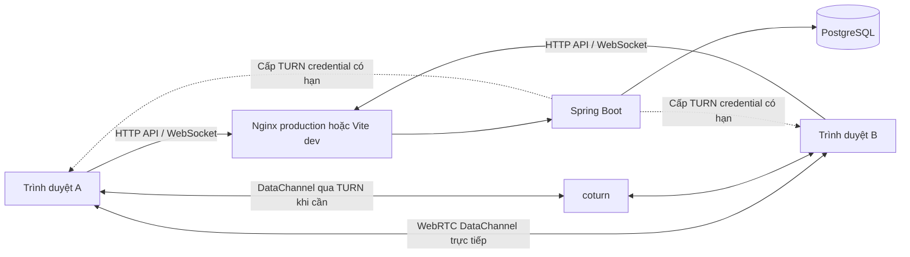
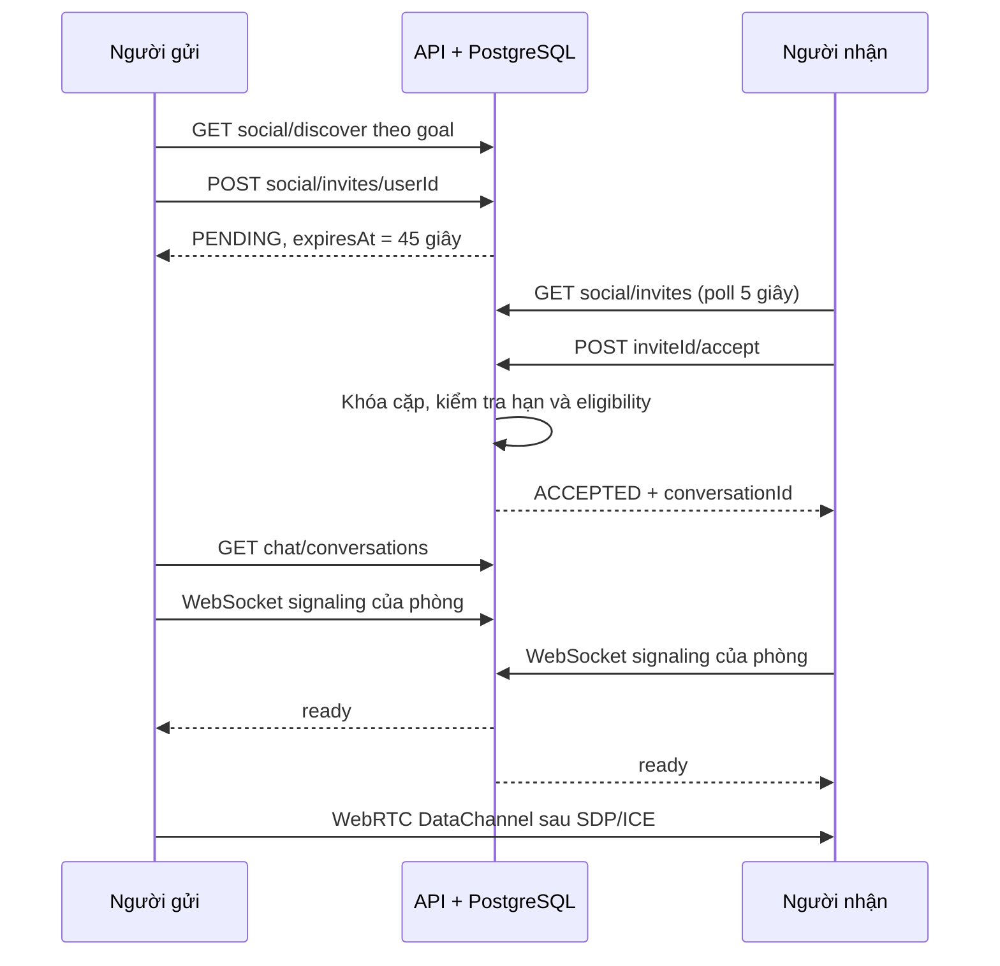

# Nexory Peerly — Kiểm tra API, tiến độ và hướng dẫn vận hành

Ngày kiểm tra: **12/10/2026**, múi giờ Asia/Saigon. Báo cáo phản ánh source và các lần chạy thực tế trong đợt kiểm tra này; không phải cam kết hệ thống không bao giờ có lỗi.

## 1. Kết luận về mức độ hoàn thiện

**Các luồng chính của MVP đã hoạt động và được kiểm thử:** tài khoản → hồ sơ → khám phá → like/match hoặc lời mời Social → phòng riêng → signaling → chat WebRTC. Đã gửi tin hai chiều bằng hai browser context độc lập qua cả kết nối trực tiếp và TURN bắt buộc. Bản Docker cũng đã chạy với PostgreSQL, Spring Boot, Nginx và coturn; chat production qua proxy Nginx đã được kiểm tra.

**Chưa thể coi là sản phẩm production hoàn chỉnh.** Các chức năng upload ảnh, reset mật khẩu/xác minh email, moderation/report, thông báo đẩy, lịch sử tin nhắn và triển khai HTTPS công khai chưa có. Việc kết nối giữa hai mạng Internet/CGNAT độc lập chưa được xác minh trong đợt này. Xem mục 12 để phân biệt phần đã làm và phần còn thiếu.

Source được chia thành hai thư mục:

```text
D:\N3 HK1\Nexora Peerly\        # Frontend, Compose, công cụ database, tài liệu
D:\N3 HK1\Nexora_Backend\       # Spring Boot API chính thức
```

Thư mục `Nexora Peerly/backend/` chỉ là migration runner cho PostgreSQL local. Compose build API từ `../Nexora_Backend`; thay đổi Java phải thực hiện trong thư mục backend chính thức.

## 2. Tiến trình kiểm tra và sửa lỗi

| Bước | Kết quả thực tế |
|---|---|
| Rà soát controller/service và frontend routes | Lập danh mục 22 HTTP operations và 1 WebSocket endpoint đang có |
| Chạy bộ backend ban đầu trên PostgreSQL Testcontainers | 19 test, 2 thất bại: assertion mutual-like sai và lỗi accept Social trả 409 |
| Sửa backend, thêm kiểm thử hồi quy và WebSocket thật | 29/29 test qua: 25 integration và 4 unit chấm điểm |
| Kiểm tra trình duyệt lần đầu | Phát hiện chọn goal mobile thiếu accessible label, assertion tên thương hiệu cũ và crash React khi nhận tin |
| Sửa UI và kết nối lại WebRTC | 9/9 E2E qua; gồm direct, TURN bắt buộc, reload một phía, block và viewport 375/768 px |
| Kiểm tra source frontend | TypeScript, ESLint, 29 unit test và Vite production build qua |
| Build và chạy Compose riêng | API/web build thành công; postgres/API/web có healthcheck khỏe |
| Kiểm tra production qua Nginx | Đăng ký, lưu hồ sơ, invite/accept, signaling và chat hai chiều qua DataChannel: qua |
| Kiểm tra công cụ trên Windows | Sửa cleanup test Java theo cây process và dùng bản sao JAR để không khóa output của Maven |

### Các lỗi đã sửa

1. **Chấp nhận Social thỉnh thoảng trả 409.** `UUID.compareTo` của Java và thứ tự UUID trong PostgreSQL không giống nhau ở ranh giới signed bit. Tạo `user_a_id`/`user_b_id` bằng SQL `LEAST/GREATEST`, đúng với constraint và trigger của database. Có regression test với hai UUID cố định ở hai phía ranh giới.
2. **Lời mời không còn đủ điều kiện gây lỗi server.** Nhánh `CANCELLED` đọc phần tử không tồn tại `invite[4]`; đã sửa về trường thời hạn đúng. Kiểm tra thực tế việc đổi goal trước khi accept.
3. **Test chat Relationship hiểu sai mutual-like.** Like đầu tiên trả `mutual=false`; like ngược chiều sau đó mới trả `true`. Sửa assertion và kiểm tra mở cùng phòng từ cả hai phía trả cùng ID.
4. **WebSocket đã mở chưa xét lại logout/hết hạn.** Handshake lưu định danh session; mỗi frame/heartbeat kiểm tra session còn hiệu lực. Session bị thu hồi đóng socket với code 1008. Thành viên đang suspended cũng không được mở signaling/phòng mới.
5. **Một người tải lại trang khiến người còn lại không thương lượng lại.** Server phát `peer-left` và `ready` khi người dùng rời/vào; frontend tạo RTCPeerConnection mới khi nhận `ready`, xử lý SDP/ICE theo hàng đợi.
6. **Dữ liệu peer có thể tự khai `own`.** Client chuẩn hóa message nhận thành `own=false`, kiểm tra kiểu, độ dài, thời gian, bỏ message trùng ID và giới hạn bộ nhớ gần nhất 1.000 tin. Gửi bị từ chối nếu DataChannel chưa mở hoặc buffer vượt giới hạn.
7. **Danh sách lời mời chỉ cập nhật thủ công.** Trang tin nhắn tải lại danh sách mỗi 5 giây; dependency theo ID giữ kết nối hiện tại khi dữ liệu được tải lại. Reconnect cùng phòng giữ tin đã hiển thị ở phía không tải lại trang.
8. **Màn hình trắng sau tin nhắn đầu.** Effect trả trực tiếp kết quả `scrollIntoView`; trên trình duyệt kiểm tra, React nhận giá trị như cleanup không hợp lệ và báo `destroy is not a function`. Đổi effect sang block không trả kết quả.
9. **Lựa chọn mục tiêu trên mobile thiếu tên truy cập.** Thêm `aria-label` theo goal cho các nút trong Discover.
10. **JAR bị khóa sau E2E trên Windows.** Java launcher có thể tạo JVM con. Fixture dừng đúng cây process nó tạo, sao chép JAR sang file riêng cho mỗi lần chạy và dọn file đó khi kết thúc.

## 3. Công nghệ thực sự đang dùng

Các phiên bản frontend dưới đây đọc từ dependency đã cài/lockfile trong lần kiểm tra, không phải chỉ khoảng phiên bản trong `package.json`.

| Thành phần | Công nghệ | Vai trò |
|---|---|---|
| Giao diện | React 19.3.0, TypeScript 5.8.3 | Component, form, state và types API |
| Điều hướng | React Router 7.18.4 | `/login`, `/register`, `/profile`, `/discover`, `/matches`, `/messages` |
| Build frontend | Vite 6.4.4, pnpm | Dev server, proxy, bundle production |
| Thiết kế | CSS, CSS variables, Lucide, Inter/Sora | Mobile responsive, design tokens, icon và font; **không dùng Tailwind trong source hiện tại** |
| Backend | Java 21, Spring Boot 3.5.16 | REST, validation, transaction, WebSocket, health |
| Data access | Spring JDBC / JdbcTemplate, HikariCP | SQL có parameter; **không dùng JPA/Hibernate** |
| Bảo mật | Spring Security, BCrypt cost 12 | Xác thực session, phân quyền theo người dùng/phòng |
| Token | Opaque bearer token 32 byte ngẫu nhiên | Base64URL dài 43 ký tự; database chỉ giữ SHA-256; **không phải JWT, chưa có refresh token** |
| Database | PostgreSQL 18 trong Compose; PostgreSQL 16 cho test fixtures | Lưu hồ sơ, session, ghép đôi, trạng thái phòng |
| Migration | Flyway 13.10.0, V1–V3 | Validate và migrate lúc API khởi động |
| Realtime | Native Spring WebSocket + browser WebRTC DataChannel | SDP/ICE qua signaling; nội dung chat qua DataChannel |
| NAT traversal | STUN và coturn 4.18.0-r0 | Tìm đường trực tiếp hoặc chuyển tiếp TURN với credential có hạn |
| Chạy production local | Docker Compose, Nginx 1.29, Node 22 builder, Java 21 runtime | Build image, phục vụ SPA, proxy và healthcheck |
| Kiểm thử | JUnit 5, MockMvc, Testcontainers, Java HttpClient WebSocket | API thật trên PostgreSQL riêng, kiểm tra socket thực |
| Kiểm thử frontend | Vitest 3.2.7, Playwright 1.64.0, Chrome | Unit, UX, responsive và DataChannel hai người dùng |

Giữ kiến trúc JDBC/session hiện hữu giúp tái sử dụng schema và code. Nếu sau này bắt buộc JWT/refresh token hoặc JPA, đó là hạng mục migration riêng; không mô tả các công nghệ này như đã triển khai.

## 4. Kiến trúc và vị trí source



| Source | Trách nhiệm |
|---|---|
| `frontend/src/App.tsx` | Router; `ProtectedRoutes` chờ khôi phục session, redirect khi chưa đăng nhập |
| `frontend/src/contexts/AuthContext.tsx` | Session trong `sessionStorage`, gọi `/me`, xử lý 401, login/logout |
| `frontend/src/api/client.ts` | HTTP client, timeout 15 giây, abort, token header, lỗi tiếng Việt |
| `frontend/src/pages/Auth/`, `Profile/`, `Discover/`, `Matches/` | Form và workflow người dùng nối API thật |
| `frontend/src/pages/Chat/MessagesPage.tsx` | Danh sách phòng/invite, polling, composer và trạng thái chat |
| `frontend/src/features/chat/services/p2pChat.ts` | WebSocket, thương lượng SDP/ICE, DataChannel, reconnect, stats đường truyền |
| Backend `auth/`, `config/` | Session, hash, filter Spring Security, CORS |
| Backend `profile/`, `catalog/` | Hồ sơ riêng từng mode và validation mã danh mục |
| Backend `discovery/`, `matching/` | Lọc, chấm điểm, like/match/block |
| Backend `chat/` | Lời mời Social và trạng thái hội thoại |
| Backend `rtc/` | Auth handshake, room signaling, kiểm tra thành viên, ICE/TURN endpoint |
| Backend `common/` | Response lỗi JSON nhất quán, không trả SQL nội bộ |
| Backend `src/main/resources/db/migration/` | Migration runtime của API |
| `docker-compose.yml`, `frontend/nginx/default.conf` | Ghép các dịch vụ và reverse proxy |

Các file demo cũ như `demoSession` còn trong source/test; router chính trong `App.tsx` sử dụng các page/API kể trên. Không lấy số unit test của module demo làm bằng chứng chat P2P đã hoạt động; bằng chứng P2P nằm ở các E2E và smoke production.

## 5. Danh mục toàn bộ HTTP API đang triển khai

`Bearer` nghĩa là header `Authorization: Bearer <accessToken>`. ID được kiểm tra kiểu UUID; người thao tác được lấy từ session, không từ user ID tùy ý trong body.

| # | Method và endpoint | Auth | Hành vi/kết quả đã kiểm tra |
|---|---|---|---|
| 1 | `GET /actuator/health` | Công khai | 200, `status=UP`, không lộ component/credential |
| 2 | `POST /api/auth/register` | Công khai | 201; tạo người dùng/session/profile mặc định; dưới 18 tuổi, JSON lỗi bị từ chối; email trùng 409 |
| 3 | `POST /api/auth/login` | Công khai | 200; tạo session riêng; mật khẩu sai 401 |
| 4 | `POST /api/auth/logout` | Bearer | 204; thu hồi session hiện tại; session khác vẫn dùng được |
| 5 | `GET /api/me` | Bearer | Thông tin tài khoản; token hết hạn/thu hồi, người dùng suspended → 401 |
| 6 | `GET /api/catalog` | Bearer | Sáu nhóm: interests, socialGoals, games, platforms, datingIntents, datingValues |
| 7 | `GET /api/social/profile` | Bearer | Hồ sơ Social của chính mình |
| 8 | `PUT /api/social/profile` | Bearer | Thay thế bio, enabled, readiness, goals, interests, games; mã sai/trùng game-platform bị từ chối |
| 9 | `GET /api/dating/profile` | Bearer | Hồ sơ Relationship của chính mình; mặc định tắt/HIDDEN |
| 10 | `PUT /api/dating/profile` | Bearer | Thay thế hồ sơ và tiêu chí; tuổi min > max hoặc catalog không hợp lệ bị từ chối |
| 11 | `GET /api/social/discover?goal=...&limit=20` | Bearer | NEW_FRIENDS/TALK/GAMING; readiness và game/crossplay được lọc theo cả hai phía |
| 12 | `GET /api/dating/discover?limit=20` | Bearer | Tuổi, visibility, intent phù hợp hai chiều; không trả email/ngày sinh/token của ứng viên |
| 13 | `POST /api/dating/likes/{userId}` | Bearer | Like đầu chưa mutual; hai chiều tạo một match; gửi lại không nhân đôi match |
| 14 | `GET /api/dating/matches` | Bearer | Match ACTIVE với đối phương ACTIVE; tối đa 100 |
| 15 | `POST /api/dating/blocks/{userId}` | Bearer | Block hai chiều về eligibility; xóa likes, vô hiệu match, hủy invite pending, kết thúc phòng |
| 16 | `GET /api/social/invites` | Bearer | Invite PENDING chưa hết hạn liên quan đến chính mình; tối đa 100 |
| 17 | `POST /api/social/invites/{userId}?goal=...` | Bearer | Tạo lời mời 45 giây; tự mời/đối tượng lạ/cặp không phù hợp/đang pending bị từ chối |
| 18 | `POST /api/social/invites/{inviteId}/accept` | Bearer | Chỉ người nhận; ACCEPTED trả `conversationId`; hết hạn → EXPIRED, mất điều kiện → CANCELLED |
| 19 | `POST /api/social/invites/{inviteId}/reject` | Bearer | Chỉ người nhận; REJECTED; phản hồi lại invite đã giải quyết → 409 |
| 20 | `GET /api/chat/conversations` | Bearer | Chỉ phòng ACTIVE của mình, không block và hai tài khoản còn ACTIVE |
| 21 | `POST /api/chat/matches/{matchId}` | Bearer | Mở phòng cho match đang hoạt động; lặp lại trả cùng phòng; người ngoài không truy cập |
| 22 | `GET /api/rtc/ice-servers` | Bearer | STUN; thêm TURN khi URL và shared secret được cấu hình; HMAC-SHA1 được đối chiếu trong test |

Toàn bộ 19 HTTP operations riêng tư được kiểm tra không-token trả 401. Giới hạn `limit` của discovery là 1–100. Các bài test còn kiểm tra CORS allowed/denied, malformed UUID, payload có trường lạ, atomic rollback và cạnh tranh like/block/accept.

Lỗi có cấu trúc:

```json
{"code":"INVALID_REQUEST","message":"...","fields":{}}
```

Các mã thường gặp: 400 dữ liệu sai; 401 session không hợp lệ; 403 origin/quyền; 404 tài nguyên không có hoặc không thuộc quyền truy cập; 409 trạng thái hoặc constraint không cho phép; 500 lỗi chưa xử lý. Frontend chuyển lỗi phổ biến sang tiếng Việt.

## 6. Hợp đồng WebSocket và WebRTC

Endpoint: `GET /ws/signaling?conversationId=<uuid>` với WebSocket upgrade.

Trình duyệt mở socket bằng hai requested subprotocols:

```typescript
new WebSocket(url, ["nexory.v1", `bearer.${accessToken}`]);
```

Server chỉ thương lượng `nexory.v1`. Token không nằm trong query URL; cần tránh ghi `Sec-WebSocket-Protocol` vào access log nếu mở rộng logging sau này.

| Frame | Chiều | Ý nghĩa |
|---|---|---|
| `ready` | Server → hai phía | Hai thành viên đã tham gia; bắt đầu thương lượng mới |
| `offer`, `answer` với `data` object | Peer → server → peer | Session description WebRTC |
| `ice` với `data` object | Peer → server → peer | ICE candidate |
| `heartbeat` | Client → server, mỗi 8 giây | Xác minh lại session và quyền trong phòng |
| `peer-left` | Server → phía còn lại | Đóng peer connection cũ; chờ đối phương quay lại hoặc reconnect |
| `ended` | Server → phòng | Phòng bị chặn/kết thúc/không còn hợp lệ |

Chỉ thành viên của phòng hợp lệ mở được socket. Server giới hạn frame text 64 KiB, từ chối JSON không hợp lệ và loại frame ngoài danh sách. Frame `chat` không được relay. Một người chỉ có một socket trong mỗi phòng; socket mới thay socket cũ.

User ID nhỏ hơn theo chuỗi UUID chuẩn làm offerer. Offerer tạo DataChannel `peerly-chat` có thứ tự. Client áp dụng SDP/ICE tuần tự; khi một người tải lại trang, `ready` tạo peer connection mới ở cả hai phía. Một người có thể nhấn **Kết nối lại** nếu signaling bị mất.

Tin nhắn đi trên DataChannel WebRTC; payload gồm `id`, `text`, `sentAt`. Giới hạn text 4.000 ký tự. UI phân biệt đường truyền direct/relay bằng selected ICE candidate stats; nếu chưa đọc được stats, chỉ báo kết nối sẵn sàng.

TURN username có dạng `<unix-expiry>:<userId>`; password là Base64(HMAC-SHA1(sharedSecret, username)). TTL mặc định 3.600 giây, giới hạn cấu hình trong 300–86.400 giây. Shared secret không trả về frontend.

**Giới hạn vòng đời:** nội dung nằm trong React memory của cuộc trò chuyện đang mở, gần nhất 1.000 tin; rời phòng/route hoặc tải lại trang có thể làm mất nội dung. Reconnect cùng phòng giữ tin đã hiển thị ở phía không reload. Không có offline delivery, delivery receipt hay lưu message server. Block/logout được client chính thức xử lý qua polling, heartbeat hoặc đóng socket; backend không thể thu hồi nội dung đã đến thiết bị.

## 7. Workflow nghiệp vụ

### Tài khoản và hồ sơ

1. Người dùng đăng ký email/password/tên/ngày sinh; API kiểm tra đủ 18 tuổi, BCrypt password và tạo session.
2. Client giữ token trong `sessionStorage`, gọi `/me` khi mở lại trang. Network error không tự xóa session; 401 xóa session và yêu cầu đăng nhập.
3. Người dùng lưu hai hồ sơ độc lập. PUT thay thế toàn bộ lựa chọn của mode tương ứng trong transaction.
4. Catalog quyết định mã hợp lệ; frontend hiển thị nhãn tiếng Việt, backend giữ code ổn định.

### Social



TALK yêu cầu cả hai `readyToConnect`; cờ này là tự khai, chưa phải online presence. GAMING yêu cầu cùng game và cùng platform, hoặc game hỗ trợ crossplay và cả hai bật crossplay. Lời mời hết hạn bị ẩn khỏi danh sách và chuyển EXPIRED khi được xử lý/gửi lại; chưa có scheduler quét mọi row cũ.

### Relationship

1. Hai hồ sơ cùng bật, DISCOVERABLE, tuổi và accepted intent phù hợp hai chiều.
2. A like B: chưa có match nếu B chưa like A.
3. B like A: tạo một match ACTIVE dưới khóa cặp; thao tác đồng thời không tạo hai match.
4. **Bắt đầu trò chuyện** gọi `POST /api/chat/matches/{matchId}`; API trả phòng hiện có hoặc tạo phòng mới.
5. Hai người cùng mở phòng → signaling → DataChannel. Block làm mất quyền và kết thúc phòng.

### Chấm điểm và database

- Social thường: Jaccard(sở thích). Gaming: `0.7 + 0.3 × Jaccard(sở thích)` sau lọc tương thích game.
- Relationship: `0.5 × Jaccard(interests) + 0.3 × intentSimilarity + 0.2 × Jaccard(values)`.
- Intent giống nhau được 1; khác nhau nhưng hai bên chấp nhận được 0,5. Kết quả làm tròn 4 chữ số thập phân, không phải xác suất ghép đôi.
- Discovery xét tối đa 200 ứng viên theo UUID rồi chấm điểm và trả theo `limit`. Chưa phải xếp hạng toàn bộ dữ liệu quy mô lớn.
- 23 bảng nghiệp vụ gồm tài khoản/session, catalogs, profile/selection, likes/matches/blocks, invites/conversations và metadata media/messages. Bảng `messages` có schema nhưng luồng chat hiện tại không ghi nội dung vào đó.
- SQL parameterized qua JdbcTemplate; mutation cặp dùng `lock_user_pair` và transaction. Trigger bảo vệ block, trạng thái và thứ tự UUID. Không sửa migration V1–V3 đã chạy; thay đổi schema tiếp theo cần migration mới đồng bộ hai nơi lưu SQL.

## 8. Chạy hệ thống local

### Backend Java và frontend Vite

PostgreSQL phải chạy và `.env` trong **Nexora_Backend** phải có thông tin kết nối đúng. Script không tự tạo database của backend.

```powershell
Set-Location "D:\N3 HK1\Nexora_Backend"
.\run.cmd
# Cửa sổ khác:
Invoke-RestMethod http://127.0.0.1:8080/actuator/health
Set-Location "D:\N3 HK1\Nexora Peerly\frontend"
pnpm install --frozen-lockfile
pnpm dev
```

API mặc định bind `127.0.0.1:8080`. Vite proxy `/api`, `/ws`, `/actuator/health` về API này; dùng `BACKEND_URL` trong cấu hình frontend nếu đổi port. `VITE_API_BASE_URL` mặc định `/api`, giúp HTTP và WS cùng origin.

Hai file `.env` ở root Compose và backend là **hai cấu hình riêng**. `run.cmd` chỉ đọc `.env` trong Nexora_Backend. Nếu local backend thiếu `TURN_URLS`/`TURN_SHARED_SECRET`, ICE endpoint chỉ trả STUN; relay cần coturn đang chạy và cùng shared secret.

### Docker Compose

```powershell
Set-Location "D:\N3 HK1\Nexora Peerly"
if (-not (Test-Path .env)) { Copy-Item .env.example .env }
# Điền mật khẩu admin, app và TURN secret riêng trước lần chạy đầu.
docker compose config --quiet
docker compose up --build -d
docker compose ps
docker compose logs --tail 100 api web turn
```

| Service | Port mặc định ở host | Ghi chú |
|---|---|---|
| web | `WEB_PORT`, mặc định 5173 | Nginx port 80 trong container; `/healthz` là health của web |
| api | `API_PORT`, mặc định 8080 | API trong container bind 0.0.0.0; host bind loopback |
| postgres | `PG_HOST_PORT`, mặc định 5433 | API dùng `postgres:5432` trong Docker network |
| turn | 3478 UDP/TCP; 49160–49200 UDP | Host binding hiện chỉ loopback, dành cho local |

Nếu đang chạy Java API trên 8080 hoặc Vite trên 5173, chọn port Compose khác qua `.env`/environment và cập nhật `CORS_ORIGINS` theo web origin. Không cần đổi source.

PostgreSQL 18 dùng `PGDATA=/var/lib/postgresql/18/docker`, volume mount `/var/lib/postgresql`. Bootstrap tạo app role/database khi volume mới; Flyway của API chạy V1–V3. Thay mật khẩu trong `.env` không tự thay password của role đã tồn tại trong volume.

`docker compose down` dừng stack nhưng giữ dữ liệu. `down -v` xóa volume và dữ liệu, chỉ dùng cho stack kiểm thử có thể bỏ.

## 9. Biến môi trường

| Biến | Nơi dùng / ý nghĩa |
|---|---|
| `DB_HOST`, `DB_PORT`, `DB_NAME`, `DB_USERNAME`, `DB_PASSWORD` | Kết nối PostgreSQL của API/local runner |
| `POSTGRES_USER`, `POSTGRES_PASSWORD` | Admin dùng để bootstrap container PostgreSQL |
| `PG_HOST_PORT` | Port PostgreSQL được publish ra host, tách với 5432 nội bộ |
| `SERVER_ADDRESS`, `SERVER_PORT` | Bind API; local mặc định loopback, Docker 0.0.0.0:8080 |
| `WEB_PORT`, `API_PORT` | Port publish Compose |
| `CORS_ORIGINS` | Danh sách origin được HTTP/WebSocket chấp nhận, phân tách bằng dấu phẩy |
| `TURN_URLS` | Ví dụ `turn:host:3478?transport=udp,turn:host:3478?transport=tcp` |
| `TURN_SHARED_SECRET` | Secret khớp giữa API và coturn, chỉ ở server |
| `TURN_EXTERNAL_IP` | Địa chỉ relay mà thiết bị client có thể truy cập |
| `TURN_TTL_SECONDS` | Thời hạn TURN credential, mặc định 3600 |
| `BACKEND_URL` | Target proxy của Vite trong dev/test |
| `VITE_API_BASE_URL` | Base URL API được nhúng vào frontend lúc build; mặc định `/api` |

## 10. Chạy lại kiểm thử

### Backend: unit, SQL transaction, REST và WebSocket

```powershell
Set-Location "D:\N3 HK1\Nexora_Backend"
.\mvnw.cmd -B -ntp test
.\mvnw.cmd -B -ntp -DskipTests package
```

Kết quả kỳ vọng hiện tại: **29 test**. Testcontainers tạo PostgreSQL 16 riêng; lệnh TRUNCATE trong integration test chỉ chạy trên database container này. JUnit chạy HTTP MockMvc và WebSocket thực trên port ngẫu nhiên. Kết quả chi tiết ở `target/surefire-reports`.

### Frontend và kiểm thử hai người dùng

```powershell
Set-Location "D:\N3 HK1\Nexora Peerly\frontend"
pnpm typecheck
pnpm lint
pnpm test
pnpm build
pnpm test:e2e
# Chỉ kiểm tra kết nối:
pnpm exec playwright test tests/connections.spec.ts
```

E2E cần Docker, Java 21, Chrome và JAR backend vừa build. `global-setup.ts` tạo PostgreSQL và coturn riêng, chạy API bằng bản sao JAR, rồi chạy Vite ở 5178 trỏ đến API kiểm thử. Cổng relay fixture là 49400–49420 UDP; không chạy hai suite này cùng lúc. TURN fixture cho phép loopback peer để kiểm tra hai browser trên cùng máy; đó là tùy chọn của fixture, không phải cấu hình khuyến nghị cho server public.

E2E không dùng tài khoản/database local đang mở. Fixture dọn đúng container/process của lần chạy. Trên Windows sử dụng `taskkill /pid <PID-do-fixture-tao> /t /f` để kết thúc cả JVM con. Trace/screenshot lúc lỗi ở `frontend/test-results`; một số screenshot UX được giữ trong `frontend/.local/e2e`.

### Kiểm tra bản Docker/Nginx trên stack tạm

Chạy trong PowerShell riêng để các environment override không ảnh hưởng phiên dev khác. Các cổng ví dụ cần đang trống. Tên project độc lập bảo đảm volume kiểm thử không trùng stack thường.

```powershell
Set-Location "D:\N3 HK1\Nexora Peerly"
$auditProject = 'nexory-audit-' + [guid]::NewGuid().ToString('N').Substring(0,8)
$env:API_PORT = '18080'
$env:WEB_PORT = '15173'
$env:PG_HOST_PORT = '15433'
$env:CORS_ORIGINS = 'http://127.0.0.1:15173,http://localhost:15173'
$env:NEXORA_COMPOSE_SMOKE_PROJECT = $auditProject
$env:NEXORA_COMPOSE_SMOKE_URL = 'http://127.0.0.1:15173'
try {
    docker compose -p $auditProject up --build -d
    if ($LASTEXITCODE -ne 0) { throw 'Compose failed' }
    Push-Location frontend
    try {
        node tests/compose-smoke.mjs
        if ($LASTEXITCODE -ne 0) { throw 'Compose smoke failed' }
    } finally { Pop-Location }
} finally {
    docker compose -p $auditProject down --volumes
}
```

Smoke script xác minh URL trỏ đến đúng container `web` có nhãn project kiểm thử trước khi tạo tài khoản. Nó kiểm tra migration/auth/profile/catalog/invite, mở hai Chrome context và gửi tin hai chiều qua Nginx WebSocket + DataChannel. Screenshot ở `frontend/.local/compose-mobile-chat.png`.

## 11. Vận hành và xử lý sự cố

| Hiện tượng | Kiểm tra và xử lý |
|---|---|
| API không khởi động | Đọc `.local/backend-run.log` khi chạy nền, hoặc `docker compose logs api`; kiểm tra PostgreSQL, role/password và port |
| API health UP nhưng frontend lỗi | Kiểm tra `BACKEND_URL`, URL web thật và `CORS_ORIGINS`; xác nhận frontend đang dùng cùng API mong muốn |
| 401 sau đăng nhập lâu | Session hết hạn/thu hồi hoặc tài khoản suspended; đăng nhập lại; chưa có refresh-token flow |
| Không có ứng viên | Bật đúng profile/visibility, chọn cùng goal, kiểm tra readiness, game/platform/crossplay, tuổi/intent hai chiều |
| Social accept EXPIRED/CANCELLED | Lời mời chỉ sống 45 giây; gửi lại nếu đủ điều kiện. Hủy đúng là workflow bình thường, không phải lỗi server |
| Phòng mãi connecting | Hai người phải cùng mở đúng phòng; kiểm tra WebSocket 101 và allowed origin; thử reconnect |
| WebSocket 403 | Token/protocol, Origin hoặc membership không đúng; không bỏ qua kiểm tra quyền để làm socket mở được |
| Direct không được và không có relay | Kiểm tra ICE endpoint có TURN entry, shared secret khớp, hostname/IP/cổng TURN truy cập được |
| Chạy được cùng máy nhưng không qua Internet | Loopback không dùng cho thiết bị khác; cần hostname/IP public, port mappings phù hợp, firewall và HTTPS/WSS |
| Maven không rename được JAR trên Windows | Một JVM đang dùng file output. Dừng đúng tiến trình sử dụng file; E2E mới dùng bản sao JAR để tránh tình huống này |
| Migration checksum mismatch | Không sửa V1–V3 đã chạy; kiểm tra bản SQL nào được thay và dùng migration mới, không reset dữ liệu để che lỗi |

Khi triển khai public, cần cấu hình HTTPS/WSS, origin đúng và TURN hostname/IP public. Mapping TURN hiện bind `127.0.0.1`, nên phải chủ động đổi binding cho listener/relay khi cho client bên ngoài truy cập; chỉ đổi `TURN_EXTERNAL_IP` chưa đủ. Không cần public port PostgreSQL nếu API cùng Docker network.

Signaling room registry nằm trong memory của **một API instance**. Restart mất các socket hiện tại; client phải reconnect. Muốn nhiều API replica cần thiết kế room ownership/routing hoặc message broker, chưa có trong bản này.

## 12. Phần còn thiếu và phạm vi chưa kiểm chứng

| Hạng mục | Trạng thái |
|---|---|
| Tài khoản, hồ sơ, catalog, discover, like/match/block | Đã kiểm tra API và UX |
| Invite Social, phòng Relationship, privacy/membership | Đã kiểm tra cả happy path, lỗi và một số tình huống đồng thời |
| Signaling, direct chat, TURN bắt buộc | Đã xác minh hai trình duyệt độc lập trên máy hiện tại |
| Bản production qua Docker/Nginx | Đã build, chạy health và gửi tin hai chiều |
| Cross-network Internet, CGNAT, Wi-Fi/4G, Safari/iOS thực | Chưa kiểm tra; viewport mobile không thay thế thiết bị thật |
| JWT + refresh token | Chưa triển khai; hiện dùng opaque server session có thu hồi |
| Upload ảnh/media | Chưa có API/storage workflow; chỉ có bảng metadata |
| Xác minh email/tuổi, quên mật khẩu, account recovery | Chưa triển khai |
| Report, moderation, admin UI, rate limiting/captcha | Chưa triển khai |
| Offline messages, history sync, delivery/read receipts | Chưa triển khai; chat tạm thời |
| Notification, online presence, gọi thoại/video, chia sẻ file | Chưa triển khai |
| PWA offline/service worker | Chưa triển khai; mới có manifest/icon |
| Nhiều API replica, room broker, load test, tối ưu N+1 discovery | Chưa triển khai/đo tải; discovery hiện giới hạn 200 ứng viên |
| Expiry scheduler và dọn session/invite lịch sử | Chưa có job định kỳ; hết hạn được kiểm tra ở truy vấn/thao tác |
| CI/CD, public TLS deployment, backup/restore drill | Chưa thiết lập và chưa diễn tập trong đợt kiểm tra |

Ưu tiên tiếp theo nên là triển khai HTTPS/TURN public và kiểm tra hai mạng độc lập; sau đó bổ sung chống lạm dụng, xác minh/khôi phục tài khoản và backup. Những tính năng sản phẩm như media hoặc lịch sử chat cần chốt yêu cầu lưu trữ/quyền riêng tư trước khi mở rộng.

## 13. Bằng chứng trong workspace

- Backend test: `D:\N3 HK1\Nexora_Backend\target\surefire-reports`.
- Log backend audit: `D:\N3 HK1\Nexora_Backend\.local\api-audit-tests.log` (29 test qua; lần đóng gói đầu gặp khóa JAR đã được sửa, package chạy lại ở `api-audit-package.log`).
- Full browser suite: `frontend/.local/connections-audit.log` — 9 E2E qua.
- Rerun kết nối sau cập nhật fixture: `frontend/.local/connections-final.log`.
- Docker build/start: `.local/docker-audit-build.log`, `.local/compose-audit-start.log`.
- Production smoke: `frontend/.local/compose-smoke.log`.

Các log/test artifacts trong `.local` và `test-results` được ignore trong Git; giữ chúng nếu cần đối chiếu lần chạy này. Không đưa `.env`, token hay dữ liệu tài khoản thật vào báo cáo/commit.
