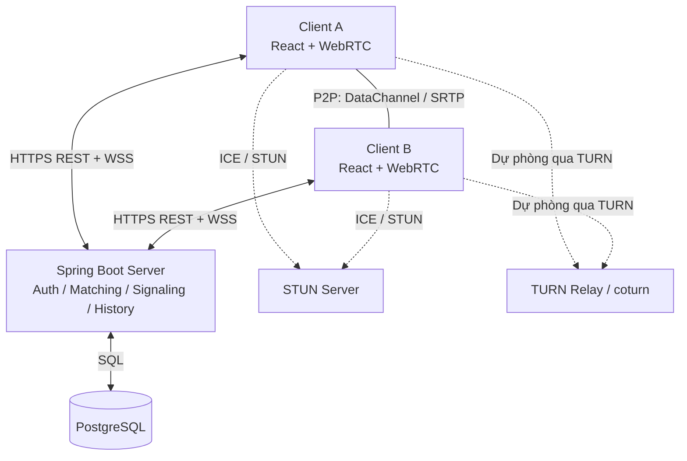
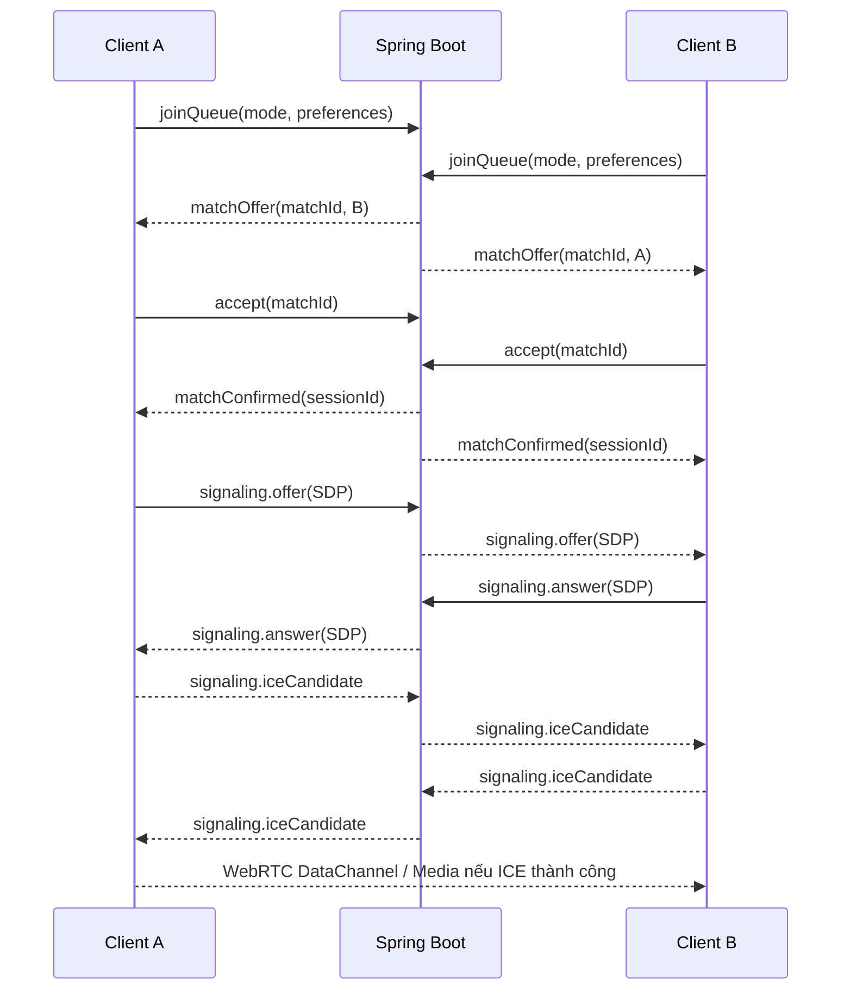
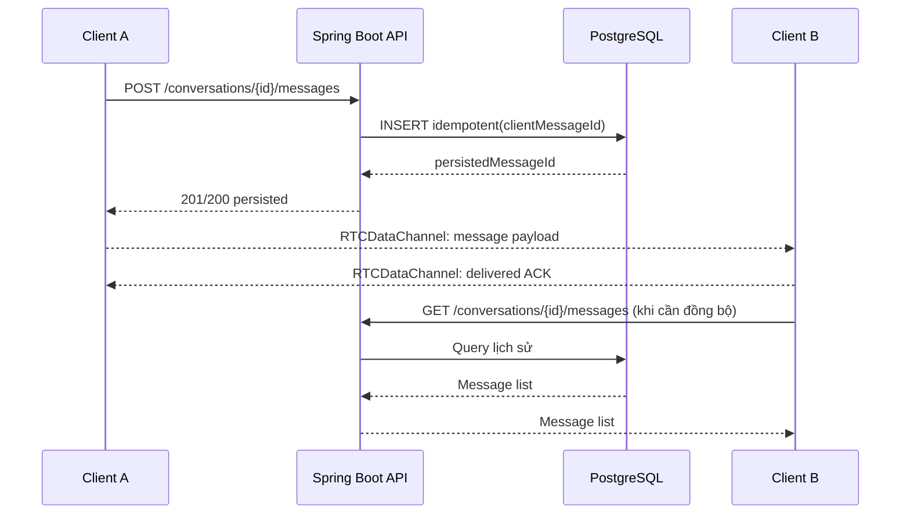
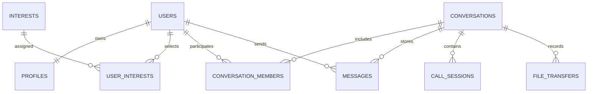

# NEXORY PEERLY
## Đặc tả kỹ thuật, kiến trúc hệ thống, chức năng và kế hoạch triển khai

> **Đề tài đề xuất:** Xây dựng ứng dụng web Nexory Peerly hỗ trợ ghép cặp theo nhiều chế độ và giao tiếp thời gian thực theo kiến trúc Hybrid Peer-to-Peer (Hybrid P2P).
>
> **Học phần:** Đồ án Cơ sở 4 (1 tín chỉ) — Học kỳ 1, năm học 2026–2027  
> **Số lượng thực hiện:** 01 sinh viên  
> **Nền tảng đã chốt:** Web App, React, Java Spring Boot, PostgreSQL, Hybrid P2P  
> **Phiên bản tài liệu:** 1.0 — 09/10/2026  
> **Trạng thái:** Tài liệu đặc tả và kế hoạch **đề xuất**; cần được giảng viên hướng dẫn phê duyệt trước khi xem là phạm vi cam kết chính thức.

---

## 1. Căn cứ và định hướng đề tài

### 1.1. Căn cứ theo thông báo của khoa

Tài liệu được xây dựng có tham chiếu **Thông báo số 94/TB-KHMT ngày 14/09/2026** về triển khai Đồ án Cơ sở 4 (1TC), học kỳ 1, năm học 2026–2027, của Khoa Khoa học Máy tính, Trường Đại học Công nghệ Thông tin và Truyền thông Việt–Hàn.

Theo thông báo, các định hướng được nêu bao gồm **ứng dụng/hệ thống Client–Server, Peer to Peer** và các hướng khác như AI, lập trình hệ thống, hệ điều hành. Đồ án hướng đến việc vận dụng kiến thức đã học vào một sản phẩm/ứng dụng thực tiễn. Kết quả cần có sản phẩm, hồ sơ phân tích và thiết kế hệ thống, mã nguồn hoặc mô hình/demo; báo cáo tổng kết `.doc` tối thiểu **20 trang nội dung** (không tính mục lục, tài liệu tham khảo, phụ lục) và slide báo cáo bằng **tiếng Anh**.

**Đối chiếu:** Nexory Peerly phù hợp với *hướng đề xuất* ứng dụng trên nền tảng mạng **Client–Server/P2P** nếu đồ án thực sự triển khai, chứng minh và kiểm thử được kênh truyền thông P2P; **không đủ** nếu chỉ có giao diện ghép cặp và toàn bộ tin nhắn đi qua máy chủ WebSocket. Đây là lập luận kỹ thuật để trao đổi với giảng viên, **không phải kết luận rằng khoa đã phê duyệt đề tài**.

**Lưu ý:** Thông báo của khoa **không quy định bắt buộc** dùng React, Java, PostgreSQL, WebRTC, STUN/TURN hay một thuật toán ghép cặp cụ thể. Những nội dung này là lựa chọn của sinh viên hoặc đề xuất kỹ thuật trong tài liệu này.

### 1.2. Vấn đề cần giải quyết

Các hệ thống nhắn tin thông thường phụ thuộc vào máy chủ để điều phối và truyền tải nội dung. Đề tài tập trung xây dựng một hệ thống ghép cặp giữa hai người dùng, trong đó:

- Máy chủ quản lý danh tính, hồ sơ, trạng thái, thuật toán tìm đối tượng phù hợp, yêu cầu kết nối và lịch sử đã lưu.
- Sau khi hai bên **đồng ý kết nối**, trình duyệt thiết lập phiên **WebRTC** để truyền tin nhắn, tệp và âm thanh/hình ảnh trực tiếp nếu mạng cho phép.
- Khi kết nối trực tiếp gặp trở ngại do NAT/tường lửa, có thể sử dụng **TURN relay**; hệ thống vẫn theo kiến trúc Hybrid P2P nhưng phiên đó **không còn là truyền trực tiếp end-to-end ở lớp mạng**.

### 1.3. Mục tiêu

1. Xây dựng web app có đăng ký, đăng nhập, quản lý hồ sơ và lưu lịch sử trò chuyện.
2. Xây dựng cơ chế ghép cặp hỗ trợ **nhiều chế độ** dựa trên ngẫu nhiên và độ tương đồng; có lời mời, đồng ý/từ chối và kết thúc kết nối.
3. Xây dựng hệ thống tín hiệu (signaling) dựa trên Java Spring Boot để trao đổi thông tin thiết lập WebRTC.
4. Thiết lập kết nối WebRTC một-một, sử dụng **RTCDataChannel** cho tin nhắn/tệp, **RTCPeerConnection + MediaStream** cho gọi thoại/video.
5. Thiết kế PostgreSQL để lưu tài khoản, hồ sơ, sở thích, lịch sử ghép cặp, phiên và lịch sử tin nhắn.
6. Đo đạc, chứng minh sự khác biệt giữa **đường đi dữ liệu P2P** và **đường đi tín hiệu/quản trị qua máy chủ** trong demo.

### 1.4. Giới hạn đề tài

- Phạm vi chính: **1–1**, không làm nhóm nhiều người trong bản bắt buộc.
- Hệ thống **cần Internet hoặc mạng IP thông suốt**; không đồng nghĩa với nhắn tin ngoại tuyến hoàn toàn.
- Không mặc định có ứng dụng Android/iOS native.
- Không xây dựng mạng P2P thuần túy hoặc tự viết lại giao thức WebRTC.
- Không cam kết NAT traversal thành công 100%; TURN là phương án dự phòng.
- Không yêu cầu AI/ML cho thuật toán ghép cặp phiên bản đầu tiên.

---

## 2. Phạm vi chức năng và thứ tự ưu tiên

### 2.1. Cách đọc mức ưu tiên

- **B0 — Bắt buộc để chứng minh giá trị đồ án:** Phải chạy được khi demo phiên bản tối thiểu và là phần ưu tiên cao nhất.
- **B1 — Bắt buộc theo bộ chức năng đã chọn:** Mục tiêu hoàn thiện của đề tài, gồm gửi tệp và gọi thoại/video; triển khai sau khi B0 ổn định.
- **N — Nâng cao / ngoài phạm vi cam kết cơ bản:** Chỉ thực hiện khi còn thời gian và được giảng viên đồng ý.

> Với **01 sinh viên** và thời hạn ngắn, thứ tự triển khai không đồng nghĩa được tùy ý bỏ B1. Nếu thiếu thời gian cần báo giảng viên để **điều chỉnh phạm vi chính thức**, không ghi là đã hoàn thành chức năng chưa có.

### 2.2. Danh mục chức năng

| Mã | Chức năng | Mô tả và tiêu chí đạt tối thiểu | Ưu tiên |
|---|---|---|---|
| FR-01 | Đăng ký/đăng nhập/đăng xuất | Tạo tài khoản, xác thực, đổi phiên hợp lệ; mật khẩu được băm | B0 |
| FR-02 | Hồ sơ người dùng | Tên hiển thị, ảnh đại diện (có thể chọn mặc định), phần giới thiệu, sở thích | B0 |
| FR-03 | Trạng thái sẵn sàng | Trực tuyến / đang ghép / đang trò chuyện; chống ghép trùng | B0 |
| FR-04 | Chọn chế độ ghép | **Ngẫu nhiên**, **theo sở thích**, **kết hợp** | B0 |
| FR-05 | Tìm ứng viên và xếp hạng | Lọc đối tượng hợp lệ, tính điểm/đảo ngẫu nhiên theo chế độ | B0 |
| FR-06 | Yêu cầu kết nối | Gửi lời mời, thông báo thời gian thực, nhận hoặc từ chối, timeout | B0 |
| FR-07 | Signaling WebRTC | Chuyển tiếp offer/answer/ICE candidate cho **đúng cặp đã chấp thuận** | B0 |
| FR-08 | Nhắn tin P2P | Văn bản 1–1 qua RTCDataChannel, thời gian thực | B0 |
| FR-09 | Lưu lịch sử tin nhắn | Đồng bộ nội dung văn bản lên PostgreSQL; tải lại sau đăng nhập | B0 |
| FR-10 | Quản lý phiên | Kết thúc chat, ngắt kết nối, hủy tìm, xử lý mất mạng cơ bản | B0 |
| FR-11 | Chứng minh đường truyền | Demo phân biệt WebSocket signaling và WebRTC DataChannel; quan sát ICE candidate | B0 |
| FR-12 | Gửi tệp P2P | Chọn tệp, chia chunk, truyền qua DataChannel, nhận và tải về | B1 |
| FR-13 | Gọi thoại 1–1 | Xin quyền micro, thiết lập audio track, bật/tắt mic, kết thúc | B1 |
| FR-14 | Gọi video 1–1 | Xin quyền camera, thiết lập video track, bật/tắt camera, kết thúc | B1 |
| FR-15 | Trạng thái gửi/nhận | ACK cơ bản, thông báo gửi thành công/thất bại; không hiển thị sai trạng thái | B1 |
| FR-16 | Chặn/báo cáo | Chặn người dùng, không ghép lại; báo cáo được lưu cho quản trị | B1 |
| FR-17 | Ghép theo vị trí gần | Chỉ khi người dùng tự nguyện cho phép vị trí; không lưu tọa độ chính xác không cần thiết | N |
| FR-18 | Gợi ý dựa trên hành vi/AI | Mô hình học từ dữ liệu có sự đồng ý, so với scoring thủ công | N |
| FR-19 | Nhóm chat / cuộc gọi nhóm | Nhiều peer hoặc kiến trúc SFU khác | N |
| FR-20 | Thông báo đẩy / đa thiết bị | Web Push, nhiều phiên một tài khoản, đồng bộ nâng cao | N |
| FR-21 | Mã hóa đầu cuối cho dữ liệu lưu trữ | Quản lý khóa thiết bị/phiên riêng ngoài mã hóa truyền tải WebRTC | N |

**Kết luận về phạm vi:** Bản demo tối thiểu phải có **đăng nhập → chọn chế độ ghép → hai bên chấp thuận → kết nối WebRTC → chat P2P → lưu/khôi phục lịch sử**. Tệp và thoại/video là chức năng **đã được lựa chọn cho sản phẩm mục tiêu**, nên triển khai và kiểm thử như các module B1, không đánh đồng với chức năng N.

### 2.3. Vai trò người dùng

- **Khách:** Xem trang giới thiệu; đăng ký và đăng nhập.
- **Người dùng đã xác thực:** Cập nhật hồ sơ, chọn chế độ, tìm người, chấp nhận/từ chối, chat, gọi điện, gửi tệp, xem lịch sử, chặn người dùng.
- **Quản trị viên:** *Đề xuất tối giản*, chỉ cần API/trang quản trị báo cáo nếu kịp tiến độ; không bắt buộc làm bảng điều khiển phức tạp.

---

## 3. Ngôn ngữ, công nghệ và công cụ

| Tầng | Công nghệ | Vai trò | Quyết định |
|---|---|---|---|
| Frontend | **React** | Giao diện SPA, trang ghép cặp, chat, cuộc gọi | Đã chốt |
| Frontend language | **TypeScript**, HTML, CSS | Mã an toàn kiểu dữ liệu, tích hợp WebRTC APIs | **Đề xuất** (React không bắt buộc TS) |
| Build frontend | Vite | Chạy dự án và build giao diện | Đề xuất |
| Backend | **Java + Spring Boot** | REST API, WebSocket signaling, xác thực, ghép cặp, nghiệp vụ | Đã chốt |
| Java version | Java LTS tương thích với Spring Boot chọn | Môi trường phát triển ổn định | Đề xuất; khóa phiên bản khi khởi tạo |
| Cơ sở dữ liệu | **PostgreSQL** | Tài khoản, hồ sơ, ghép cặp, hội thoại và tin nhắn | Đã chốt |
| ORM / migration | Spring Data JPA + Flyway | Truy cập DB, quản lý schema có phiên bản | Đề xuất |
| Xác thực | Spring Security; access token hoặc cookie phiên | Giới hạn API và signaling theo người dùng | Đề xuất |
| Realtime điều phối | Spring WebSocket (JSON hoặc STOMP) | Presence, ghép cặp, invite, signaling | Đề xuất |
| Dữ liệu P2P | **WebRTC RTCDataChannel** | Truyền văn bản và chunk tệp | Công nghệ kỹ thuật đề xuất |
| Audio/video | **WebRTC MediaStream/RTCPeerConnection** | Truyền audio/video giữa các trình duyệt | Công nghệ kỹ thuật đề xuất |
| NAT traversal | STUN + **coturn** (TURN khi cần) | ICE discovery và relay dự phòng | Đề xuất, nên chuẩn bị cho demo khác mạng |
| Kiểm thử API | Postman hoặc Bruno | Test REST/WS thủ công | Tùy chọn |
| Test backend | JUnit, Spring Boot Test | Test thuật toán, bảo mật và API | Đề xuất |
| Triển khai | Docker Compose (app, PostgreSQL, coturn) | Dễ lặp lại demo | Đề xuất, không bắt buộc |
| Quản lý nguồn | Git + GitHub/GitLab | Quản lý phiên bản, minh chứng tiến độ | Đề xuất |

**Không khuyến nghị đưa vào MVP nếu chưa cần:** Redis, Kafka, microservices, AI/ML, Kubernetes, SFU server. Với một sinh viên, kiến trúc **modular monolith** cho Spring Boot là phù hợp hơn để kiểm soát độ phức tạp.

---

## 4. Kiến trúc Hybrid P2P

### 4.1. Sơ đồ tổng quan



> Sơ đồ mô tả **kiến trúc logic**. Đường liền giữa hai client chỉ tồn tại khi ICE chọn đường kết nối trực tiếp; trong một số điều kiện mạng, truyền thông có thể đi **qua TURN relay** (đường dự phòng).

### 4.2. Phân chia trách nhiệm

| Nhiệm vụ | Client React | Spring Boot | PostgreSQL | STUN/TURN |
|---|---:|---:|---:|---:|
| Hiển thị giao diện, xin mic/camera | ✓ |  |  |  |
| Đăng nhập, hồ sơ, phân quyền | UI | ✓ | ✓ |  |
| Hàng đợi ghép cặp và quyết định chọn người | UI | ✓ | Trạng thái cần lưu |  |
| Gửi invite, accept/reject | UI | ✓ qua WSS | Lưu phiên |  |
| Trao đổi SDP, ICE candidate | WebRTC | ✓ chuyển tiếp | Không bắt buộc lưu | STUN/TURN hỗ trợ mạng |
| Nhắn tin trực tiếp thời gian thực | **✓ P2P DataChannel** | Không truyền nội dung trên kênh chính |  | TURN có thể relay |
| Gửi tệp | **✓ P2P DataChannel** | Điều phối và giới hạn quyền | Chỉ lưu metadata nếu cần | TURN có thể relay |
| Cuộc gọi 1–1 | **✓ WebRTC media** | Chuyển tiếp signaling | Metadata phiên | TURN có thể relay |
| Lưu và truy xuất lịch sử chat | UI | **✓ REST API** | **✓** |  |

### 4.3. Vì sao đây là Hybrid P2P?

- **Phần tập trung (Client–Server):** tài khoản, dữ liệu hồ sơ, danh sách sẵn sàng, ghép cặp, chấp thuận, signaling, đồng bộ lịch sử.
- **Phần P2P:** trình duyệt trao đổi trực tiếp dữ liệu trò chuyện và media qua WebRTC khi ICE kết nối được theo đường peer-to-peer.
- **Phần relay dự phòng:** TURN chuyển tiếp lưu lượng khi đường trực tiếp bị chặn; khi đó **không được tuyên bố mọi phiên đều truyền trực tiếp**.

**Không được nhầm:** WebSocket giữa client và server chỉ dùng cho signaling, presence và sự kiện ghép cặp; bản thân WebSocket không tự biến ứng dụng thành P2P.

### 4.4. Quyết định về lưu lịch sử và quyền riêng tư

Yêu cầu đã chọn là **lưu lịch sử chat**. Giải pháp thực tế cho đồ án:

1. Sau khi người gửi tạo tin nhắn với `clientMessageId` duy nhất, frontend gọi REST API xác thực để **lưu bản sao văn bản** vào PostgreSQL.
2. Frontend đồng thời/tiếp theo truyền nội dung tin nhắn tới peer bằng `RTCDataChannel` và chờ **application ACK** từ peer (khác với ACK nội bộ của giao thức).
3. Khi đọc lịch sử, client gọi API; bản ghi được chống trùng bằng `clientMessageId` và `conversationId`.
4. Khi mất DataChannel, tin vẫn có thể được lấy từ lịch sử máy chủ khi kết nối lại. Nếu chủ động bổ sung cơ chế server-forward dự phòng, phải ghi rõ đây là **fallback Client–Server**, không gắn nhãn P2P cho đường đó.

**Giới hạn minh bạch:** Nội dung lưu dạng rõ trên server (dù truyền bằng HTTPS và mã hóa ổ đĩa) **không phải mã hóa đầu cuối (E2EE) cho lịch sử**. WebRTC mã hóa dữ liệu **trên đường truyền**, không mặc nhiên bảo vệ nội dung mà backend được cấp để lưu. Để có E2EE hoàn chỉnh cần thiết kế khóa và cơ chế đồng bộ riêng; xếp vào mức N.

Với **tệp**, bản cơ bản ưu tiên **truyền P2P và tải về ở máy nhận**, server chỉ lưu tên, kích thước, loại tệp, kết quả truyền (nếu cần), **không tự động lưu lại bytes để tải về sau**. Cần hiển thị rõ giới hạn này cho người dùng.

---

## 5. Quy trình hoạt động chính

### 5.1. Đăng nhập và tham gia hàng chờ

1. Người dùng đăng nhập qua HTTPS, nhận phiên xác thực.
2. Client kết nối WSS và tự chứng thực.
3. Người dùng chọn chế độ ghép và tham số sở thích (nếu có).
4. Server kiểm tra người dùng chưa ở một cuộc ghép đang hoạt động; thêm vào hàng chờ của chế độ phù hợp.
5. Server tìm ứng viên hợp lệ, tạm **reserve** cặp và gửi lời mời tới hai bên hoặc theo mô hình từng bước được chốt.
6. **Chỉ khi cả hai chấp thuận**, server tạo `conversation/session`, cấp quyền trao đổi signaling.

### 5.2. Ghép cặp và WebRTC signaling



**Ràng buộc signaling:** Server chỉ chuyển SDP/ICE giữa hai user thuộc **session được xác nhận**; từ chối sự kiện sai `sessionId`, sai người gửi hoặc phiên đã kết thúc.

### 5.3. Tin nhắn và đồng bộ



Các bản tin sử dụng `clientMessageId` và `messageId` để chống lặp khi đồng bộ. Nếu A chưa nhận ACK, giao diện không được ghi **“đã nhận”** chỉ vì POST tới server thành công. Khi DataChannel lỗi, có thể ghi **“đã lưu, chưa xác nhận gửi trực tiếp”**.

### 5.4. Gửi tệp

- Người gửi chọn tệp và xác nhận người nhận; kiểm tra giới hạn kích thước/loại tệp.
- Tạo metadata: `fileId`, tên, kích thước, MIME type, checksum (tùy chọn).
- Chia dữ liệu thành các khối phù hợp, truyền qua `RTCDataChannel` theo trình tự.
- Kiểm tra `bufferedAmount`, dừng chờ khi bộ đệm cao để tránh tràn bộ nhớ; hiển thị tiến độ và trạng thái hủy.
- Người nhận ghép các khối, kiểm tra kích thước/checksum, hiển thị thao tác tải xuống; mặc định **không tự mở tệp nguy hiểm**.

**MVP thực tế cho FR-12:** Giới hạn thử nghiệm khoảng **10 MB/tệp** (con số *đề xuất*, có thể điều chỉnh bằng kiểm thử), truyền từng tệp một; chưa cần resume sau khi đóng trình duyệt và chưa hỗ trợ đồng bộ tệp đa thiết bị.

### 5.5. Gọi thoại/video

- Gửi lời mời cuộc gọi trong phiên đã xác thực; bên kia chấp nhận hoặc từ chối.
- Trình duyệt xin cấp quyền micro/camera qua `getUserMedia` (**yêu cầu secure context**: HTTPS hoặc môi trường localhost phù hợp).
- Thêm `MediaStreamTrack` vào `RTCPeerConnection`, thực hiện negotiation khi cần.
- Media chạy qua WebRTC với mã hóa truyền tải; cho phép tắt/bật mic, camera, kết thúc cuộc gọi.
- Xử lý tình huống từ chối quyền thiết bị, không có camera, ICE failure và mất kết nối.

**Lưu ý kỹ thuật:** Không gửi luồng camera qua `RTCDataChannel` bằng cách tự chia frame cho bản này; sử dụng các audio/video track chuẩn của WebRTC.

---

## 6. Thuật toán ghép cặp

### 6.1. Các chế độ bắt buộc

| Chế độ | Tên gợi ý trên UI | Nguyên tắc |
|---|---|---|
| M1 | Random | Chọn ngẫu nhiên trong tập ứng viên hợp lệ đang chờ |
| M2 | Interest Match | Ưu tiên ứng viên có sở thích tương đồng |
| M3 | Balanced Match | Kết hợp tương đồng sở thích, thời gian chờ và thành phần ngẫu nhiên |

**Lưu ý:** “Nhiều tiêu chí” trong bản khả thi có thể gồm **sở thích, trạng thái hiện tại, thời gian chờ và mức độ ưu tiên ngẫu nhiên**. Ghép theo vị trí địa lý và các bộ lọc nhân khẩu học chưa được người dùng chốt; không thu thập dữ liệu nhạy cảm chỉ để làm đẹp thuật toán.

### 6.2. Lọc ứng viên trước khi chấm điểm

Một người `v` chỉ là ứng viên của `u` nếu:

- `u != v`, cả hai đã xác thực và đang trong trạng thái sẵn sàng.
- Không người nào đang thuộc phiên ghép/cuộc trò chuyện khác.
- Không có quan hệ **blocked** theo cả hai chiều.
- Không nằm trong danh sách đã từ chối gần đây, trong thời gian cooldown cấu hình.
- Hai bên thỏa các bộ lọc được **chủ động bật** (nếu hệ thống cung cấp).

Lọc điều kiện là **hard constraints**, không để một điểm tương đồng cao vượt qua điều kiện an toàn hoặc đồng ý.

### 6.3. Hàm tính điểm đề xuất

Sử dụng Jaccard similarity cho tập sở thích của `u` và `v`:

\[
J(u,v)=\frac{|I_u\cap I_v|}{|I_u\cup I_v|}
\]

Nếu cả hai đều chưa khai báo sở thích, đặt `J(u,v)=0` (không chia cho 0). Định nghĩa:

- `W(v) = min(waitSeconds(v) / Wmax, 1)` là điểm công bằng theo thời gian chờ.
- `R(u,v)` là giá trị ngẫu nhiên trong khoảng `[0,1]`, được tạo cho lần lựa chọn hiện tại.

Điểm của chế độ Balanced:

\[
S(u,v)=0.60\,J(u,v)+0.25\,W(v)+0.15\,R(u,v)
\]

**Hệ số 0.60/0.25/0.15 là giả định thiết kế, không phải thông số khoa yêu cầu hoặc tối ưu đã kiểm chứng**; có thể điều chỉnh bằng kiểm thử. Chế độ M1 **không sử dụng điểm này** mà xáo trộn ngẫu nhiên; M2 có thể ưu tiên `J`, dùng thời gian chờ để phá hòa.

### 6.4. Giả mã thuật toán

```text
function findMatch(user U, mode):
    assert U.status == SEARCHING
    candidates = listOnlineSearchingUsersExcluding(U)
    candidates = filterBySecurityConsentCooldown(candidates, U)
    if candidates is empty:
        return WAIT

    if mode == RANDOM:
        ordered = shuffle(candidates)
    else if mode == INTEREST:
        ordered = sortDescending(candidates, by Jaccard(U, V), then waitTime)
    else:  // BALANCED
        ordered = sortDescending(candidates, by balancedScore(U, V))

    for V in ordered:
        if atomicallyReservePair(U, V, ttl=30s):
            inviteBothUsers(U, V)
            return INVITED

    return WAIT

onInvitationDecision(matchId, user, decision):
    verifyMembershipAndReservation(matchId, user)
    if decision == REJECT or invitationExpired:
        releaseReservation(matchId)
        applyCooldownIfNeeded(matchId)
    else if acceptedByBoth(matchId):
        createSessionAtomically(matchId)
        setBothUsersStatus(CHATTING)
        allowSignalingForSession(matchId)
```

### 6.5. Tránh race condition và starvation

- Khi chạy **một backend instance**, có thể dùng cơ chế đồng bộ/hàng đợi tập trung kết hợp cập nhật trạng thái có điều kiện trong PostgreSQL; không dựa vào mỗi `Set` ở frontend.
- Thực thi `reserve` và `createSession` dưới transaction, có khóa/điều kiện cập nhật để **một user không ở hai cặp cùng lúc**.
- `matchId` có TTL (ví dụ 30 giây); quá hạn phải thu hồi reserve và khôi phục hàng chờ.
- Không gửi lời mời liên tục đến người vừa từ chối; thêm cooldown ngắn có thể cấu hình.
- `W(v)` tăng theo thời gian chờ giúp giảm hiện tượng một số tài khoản không được lựa chọn.
- Với quy mô lớn/multiple instance về sau có thể dùng Redis; **không cần Redis trong bản đầu**.

### 6.6. Đánh giá thuật toán

Ít nhất kiểm thử được các trường hợp: hàng chờ trống; một ứng viên; nhiều ứng viên; hai user yêu cầu đồng thời; từ chối; mất kết nối khi chờ; timeout; block; user quay lại queue. Thống kê **thời gian chờ** và **tỷ lệ match hợp lệ**, không khẳng định thuật toán “thông minh” chỉ vì có trọng số.

---

## 7. Thiết kế backend và API

### 7.1. Kiến trúc backend đề xuất (modular monolith)

```text
backend/
  src/main/java/.../
    auth/               # đăng ký, đăng nhập, xác thực
    user/               # người dùng và hồ sơ
    interest/           # danh mục sở thích
    matchmaking/        # queue, filter, score, invite, reserve
    conversation/       # session / lịch sử hội thoại
    message/            # lưu và phân trang tin nhắn
    signaling/          # WebSocket / SDP / ICE validation
    moderation/         # block / report (nếu triển khai)
    common/             # exception, security, DTO, config
  src/main/resources/
    application.yml
    db/migration/       # Flyway SQL
```

Ưu tiên chia theo **nghiệp vụ** thay vì chia cứng toàn bộ dự án thành `controllers/services/repositories` phẳng; không cần tách các microservice.

### 7.2. Các REST API đề xuất

| HTTP | Endpoint (ví dụ) | Chức năng |
|---|---|---|
| POST | `/api/auth/register` | Đăng ký |
| POST | `/api/auth/login` | Đăng nhập |
| POST | `/api/auth/logout` | Đăng xuất/thu hồi phiên phù hợp cơ chế auth |
| GET | `/api/users/me` | Lấy hồ sơ cá nhân |
| PATCH | `/api/users/me` | Chỉnh sửa hồ sơ/sở thích |
| GET | `/api/interests` | Danh sách sở thích |
| GET | `/api/conversations` | Danh sách lịch sử hội thoại |
| GET | `/api/conversations/{id}/messages` | Lấy tin nhắn theo trang/cursor |
| POST | `/api/conversations/{id}/messages` | Lưu tin nhắn văn bản, kiểm tra quyền và chống trùng |
| POST | `/api/users/{id}/block` | Chặn tài khoản (FR-16) |
| POST | `/api/reports` | Báo cáo (FR-16) |
| GET | `/api/health` | Kiểm tra trạng thái dịch vụ |

**Quy ước:** Mọi endpoint liên quan tin nhắn đều kiểm tra người dùng hiện tại là **thành viên hội thoại**. Không tin `senderId` do frontend tự gửi; server lấy từ phiên đã xác thực. Cần giới hạn độ dài tin nhắn, trang lịch sử và tốc độ gửi.

### 7.3. Nhóm sự kiện WebSocket đề xuất

```text
client -> server
  match.join              { mode, preferenceIds }
  match.cancel            { }
  match.accept            { matchId }
  match.reject            { matchId }
  signal.offer            { sessionId, sdp }
  signal.answer           { sessionId, sdp }
  signal.ice              { sessionId, candidate }
  session.end             { sessionId }
  call.invite             { sessionId, mediaType }
  call.accept / reject    { sessionId }

server -> client
  match.searching / offered / confirmed / expired / failed
  presence.changed
  signal.offer / answer / ice
  session.ended
  call.incoming / accepted / rejected / ended
  error                   { code, message }
```

Tất cả các sự kiện phải gắn với tài khoản đã xác thực, kiểm tra tính hợp lệ của `matchId/sessionId` và giới hạn kích thước payload. **Không tin đối tượng `userId` tùy ý do client khai báo.**

### 7.4. Định dạng gói tin trực tiếp DataChannel

```json
{
  "type": "CHAT_MESSAGE",
  "conversationId": "uuid-conversation",
  "clientMessageId": "uuid-message",
  "sentAt": "2026-11-09T10:00:00Z",
  "text": "Xin chào!"
}
```

```json
{
  "type": "CHAT_ACK",
  "conversationId": "uuid-conversation",
  "clientMessageId": "uuid-message",
  "status": "DELIVERED"
}
```

Tệp cần giao thức chunk khác với JSON text (gói `FILE_META`, binary chunk, `FILE_COMPLETE`, `FILE_ACK`). Không nên mã hóa toàn bộ tệp lớn thành Base64 JSON vì tăng kích thước và bộ nhớ.

---

## 8. Thiết kế cơ sở dữ liệu PostgreSQL

### 8.1. Các bảng cốt lõi

| Bảng | Các trường chính (đề xuất) | Mục đích |
|---|---|---|
| `users` | `id`, `email`, `password_hash`, `display_name`, `status`, `created_at` | Tài khoản |
| `profiles` | `user_id`, `bio`, `avatar_url`, `updated_at` | Thông tin hồ sơ |
| `interests` | `id`, `name` | Danh mục sở thích |
| `user_interests` | `user_id`, `interest_id` | Liên kết n–n |
| `match_requests` | `id`, `user_a_id`, `user_b_id`, `mode`, `status`, `expires_at` | Lời mời và quyết định |
| `conversations` | `id`, `created_at`, `ended_at`, `status` | Hội thoại đã tạo |
| `conversation_members` | `conversation_id`, `user_id` | Xác định quyền xem lịch sử |
| `messages` | `id`, `conversation_id`, `sender_id`, `client_message_id`, `body`, `created_at` | Lưu tin nhắn văn bản |
| `blocks` | `blocker_id`, `blocked_id`, `created_at` | Chặn ghép cặp |
| `call_sessions` | `id`, `conversation_id`, `media_type`, `started_at`, `ended_at` | Lịch sử phiên thoại/video (metadata) |
| `file_transfers` | `id`, `conversation_id`, `sender_id`, `file_name`, `size_bytes`, `status` | **Metadata**, không mặc định lưu file bytes |

### 8.2. Quan hệ chính



### 8.3. Ràng buộc dữ liệu

- `users.email` unique; không lưu mật khẩu dạng rõ; hash bằng thuật toán mật khẩu phù hợp (BCrypt/Argon2 nếu cấu hình được).
- Unique `(conversation_id, client_message_id)` để POST lặp không tạo tin nhắn trùng.
- Unique `(user_id, interest_id)`, `(conversation_id, user_id)`.
- Index `(conversation_id, created_at, id)` để phân trang tin nhắn; index các cột khóa ngoại thường dùng.
- `match_requests` có trạng thái rõ: `PENDING`, `ACCEPTED`, `REJECTED`, `EXPIRED`, `CANCELLED`.
- Presence thời gian thực **không nên phụ thuộc hoàn toàn vào cột `users.status`**, vì tab có thể đóng đột ngột; dùng heartbeat/socket lifecycle và đối soát phiên khi cần.
- Việc “một user chỉ có một session đang hoạt động” phải được bảo vệ tại **business layer và transaction**, có thể bổ sung ràng buộc DB tùy thiết kế final.
- Có chính sách xóa tài khoản, xóa lịch sử và thời hạn lưu phù hợp quy mô đồ án; không thu thập dữ liệu không cần thiết.

---

## 9. Yêu cầu phi chức năng, an toàn và giới hạn

### 9.1. Phi chức năng

| Mã | Yêu cầu | Cách kiểm tra / ngưỡng đề xuất |
|---|---|---|
| NFR-01 | Khả dụng trên trình duyệt | Kiểm thử Chrome và Firefox hoặc Edge phiên bản hỗ trợ WebRTC |
| NFR-02 | Giao diện phản hồi | Trang chính và các thao tác phổ biến phản hồi rõ trong điều kiện demo |
| NFR-03 | Ghép cặp không trùng | Hai yêu cầu đồng thời không tạo hai session active cho một user |
| NFR-04 | Kết nối realtime | 2 trình duyệt truyền tin qua DataChannel; có timeout và báo lỗi |
| NFR-05 | Độ bền lịch sử | Reload/đăng nhập lại vẫn xem được những tin đã lưu ở server |
| NFR-06 | Kiểm soát lỗi | Mất mạng, từ chối lời mời, lỗi quyền camera không làm sập ứng dụng |
| NFR-07 | Hiệu năng cơ bản | Test ít nhất 10–20 tài khoản mô phỏng (mức **đề xuất**, không phải chuẩn khoa) |
| NFR-08 | Bảo mật giao tiếp | Dùng HTTPS/WSS trong triển khai thực; WebRTC DTLS/SRTP |
| NFR-09 | Giới hạn tài nguyên | Giới hạn kích thước tin nhắn/tệp và quản lý bộ đệm DataChannel |
| NFR-10 | Khả năng trình diễn | Có kịch bản demo tái hiện được ở LAN và khác mạng nếu có TURN |

### 9.2. Kiểm soát bảo mật thiết yếu

- Xác thực và phân quyền server-side cho REST **và WebSocket**.
- Giới hạn người được gửi tín hiệu SDP/ICE và chỉ cho phép sau khi match xác nhận.
- Dùng HTTPS/WSS; không cấp credential TURN cố định, công khai dài hạn trong mã frontend; ưu tiên credential có thời hạn.
- Validate payload, giới hạn độ dài tin nhắn, rate-limit login/invite/message để giảm spam.
- Băm mật khẩu, tránh ghi token, password, SDP nhạy cảm hoặc nội dung chat vào log công khai.
- Không tự động bật camera/micro khi chưa có hành động và quyền của người dùng.
- Chỉ công khai thông tin hồ sơ cần thiết; không trả email, IP công khai hoặc dữ liệu riêng cho người được ghép nếu không được phép.
- Nếu có chức năng tải tệp, hiển thị tên/type và cảnh báo; không tự động thực thi tệp.

### 9.3. Giới hạn và giải thích trung thực

1. **WebRTC dùng mã hóa truyền tải**, nhưng bản sao lịch sử trên Spring Boot/PostgreSQL vẫn có thể đọc được nếu lưu plaintext.
2. **P2P trực tiếp không luôn khả dụng** do NAT/firewall; TURN có thể chuyển tiếp lưu lượng.
3. Nếu máy nhận offline, không thể nhận file P2P tức thời; **không hứa hẹn** tải lại file từ server nếu server chỉ lưu metadata.
4. Nếu đóng tab/mất mạng, session có thể cần tạo lại; không bảo đảm handoff thiết bị.
5. Thuật toán ghép theo sở thích có thể gặp cold-start khi người dùng không chọn sở thích; phải có random fallback.

---

## 10. Kiểm thử và tiêu chí nghiệm thu

### 10.1. Bộ kịch bản bắt buộc (B0)

| ID | Kịch bản | Kết quả mong đợi |
|---|---|---|
| TC-01 | Đăng ký rồi đăng nhập | Có tài khoản, vào được màn hình chính |
| TC-02 | Cập nhật sở thích | Dữ liệu còn khi đăng nhập lại |
| TC-03 | Hai user tham gia Random | Có lời mời hợp lệ, không ghép chính mình |
| TC-04 | Hai user chọn Interest/Balanced | Server thực thi đúng lọc và tính điểm đã thiết kế |
| TC-05 | Một user từ chối/timeout | Không mở DataChannel, trả trạng thái chính xác |
| TC-06 | Hai user đồng ý | Server cấp `sessionId`, bắt đầu signaling |
| TC-07 | Trao đổi SDP/ICE | WebRTC established hoặc báo lỗi có thể hiểu |
| TC-08 | Gửi tin nhắn trực tiếp | Tin đến peer qua DataChannel; server không làm kênh chuyển tiếp chat chính |
| TC-09 | Reload và xem lịch sử | Tin đã lưu được trả về, không trùng |
| TC-10 | Hai lời mời đồng thời đến một user | Chỉ một cặp được reserve/xác nhận |
| TC-11 | User mất kết nối hoặc kết thúc | Thu hồi session/queue đúng cách |
| TC-12 | Gửi signaling không thuộc session | Server từ chối |

### 10.2. Kịch bản cho chức năng đã chọn B1

| ID | Kịch bản | Kết quả mong đợi |
|---|---|---|
| TC-13 | Truyền tệp kích thước cho phép | Nhận đúng nội dung và kích thước, có tiến độ |
| TC-14 | Hủy tệp hoặc mất kết nối giữa chừng | Trạng thái thất bại rõ ràng, không báo hoàn tất giả |
| TC-15 | Gọi audio hai bên chấp nhận | Nghe được 2 chiều; mute/unmute hoạt động |
| TC-16 | Gọi video hai bên chấp nhận | Có remote/local stream; bật/tắt camera hoạt động |
| TC-17 | Từ chối quyền micro/camera | UI giải thích lỗi, app tiếp tục sử dụng được |
| TC-18 | Block một tài khoản | Không thể ghép lại trong trạng thái block |

### 10.3. Minh chứng P2P khi bảo vệ

- Mở **hai tài khoản trên hai trình duyệt/thiết bị**.
- Trình diễn `offer`, `answer`, `ICE candidate` đi qua WebSocket server.
- Sử dụng công cụ chẩn đoán WebRTC của trình duyệt (ví dụ `chrome://webrtc-internals`) để xem kết nối và cặp ICE candidate được chọn.
- Chứng minh sau khi peer connection thiết lập, **nội dung chat đến từ DataChannel**, không phải từ sự kiện `chat.message` do WebSocket server phát.
- Thử trên hai mạng nếu có thể; khi ICE candidate selected là `relay`, ghi nhận đúng là **TURN relay**, không nói “direct P2P”.
- Tắt signaling sau khi P2P đã thiết lập để kiểm tra mức độ độc lập **trong thời gian ngắn**, nhưng lưu ý: các tính năng lưu lịch sử/điều phối và kết nối lại vẫn cần backend. Đây chỉ là bài kiểm chứng, không là yêu cầu app hoạt động hoàn toàn không server.

---

## 11. Rủi ro và phương án xử lý

| Rủi ro | Tác động | Giảm thiểu |
|---|---|---|
| WebRTC không kết nối qua NAT | Chat/gọi lỗi trên hai mạng | Test sớm; chuẩn bị STUN/TURN, hiển thị trạng thái ICE |
| Quá nhiều tính năng với 01 sinh viên | Trễ tiến độ, khó hoàn thiện | Chia B0/B1/N; đóng băng scope theo tuần; làm demo P2P trước UI nâng cao |
| Race condition khi ghép | Một user nhận nhiều phiên | Atomic reserve, transaction, TTL, unit test concurrency |
| WebSocket ngắt trong khi RTC còn chạy | Presence lệch, không quản lý được phiên | Heartbeat, cleanup, quy tắc reconnect rõ |
| Lưu tin nhắn tạo lỗi trùng/đồng bộ | Lịch sử sai hoặc mất tin | clientMessageId idempotent, ACK đúng nghĩa, retry có giới hạn |
| Truyền tệp lớn gây tràn bộ đệm | Tab lag/crash | Giới hạn size, chunk, backpressure, kiểm tra checksum |
| Truy cập camera/mic bị từ chối | Không gọi được | Xử lý quyền, HTTPS, phân biệt lỗi thiết bị |
| Mâu thuẫn kỳ vọng bảo mật | Người dùng hiểu nhầm là E2EE | Ghi rõ bản sao trên server; không tuyên bố E2EE lưu trữ |
| Phụ thuộc máy chủ TURN công cộng | Relay không ổn định | Có cấu hình coturn kiểm soát; xác thực TURN hạn dùng |
| Thiếu thời gian viết báo cáo | Không đáp ứng yêu cầu nộp | Viết tài liệu, sơ đồ, ảnh kiểm thử song song quá trình code |

---

## 12. Kế hoạch thực hiện đến hạn nộp

### 12.1. Các mốc chính thức từ thông báo khoa

| Mốc | Nội dung theo thông báo |
|---|---|
| **11/10/2026** | Sinh viên chỉnh sửa và nộp đề cương chi tiết theo mẫu quy định lên hệ thống |
| **12/10/2026** | GVHD duyệt đề cương chi tiết |
| **16/10/2026** | Khoa kiểm tra nội dung đề tài; có thể đề xuất điều chỉnh |
| **01/12/2026** | Sinh viên kết thúc thực hiện và nộp kết quả lên hệ thống |
| **02/12/2026** | GVHD chấm hướng dẫn và đồng ý cho bảo vệ |
| **03/12/2026** | Khoa lập danh sách sinh viên được bảo vệ, hội đồng |
| **07/12/2026 – 03/01/2027** | Dự kiến thời gian bảo vệ |

> **Quan trọng:** File Markdown này là tài liệu lập kế hoạch kỹ thuật, **không thay thế** đề cương theo biểu mẫu chính thức của khoa và **không thay thế** báo cáo `.doc` tối thiểu 20 trang hoặc slide báo cáo bằng tiếng Anh.

### 12.2. Lộ trình đề xuất cho một sinh viên

| Thời gian | Công việc ưu tiên | Sản phẩm kiểm chứng |
|---|---|---|
| 09–11/10 | Chốt phạm vi, đối chiếu với GVHD, hoàn thiện đề cương theo mẫu | Đề cương nộp đúng hạn |
| 12–18/10 | Thiết kế kiến trúc, DB, luồng, khởi tạo React/Spring Boot/PostgreSQL | Backend/frontend chạy, migration đầu tiên |
| 19–25/10 | Auth, hồ sơ, sở thích, giao diện cơ bản, WS identity/presence | Đăng nhập hai user, cập nhật hồ sơ |
| 26/10–01/11 | Queue, Random/Interest/Balanced, lời mời, accept/reject, timeout | Demo ghép cặp đúng quy tắc |
| 02–08/11 | WebRTC signaling/ICE, DataChannel, kiểm thử 2 trình duyệt/mạng | **Demo P2P chat chưa cần đẹp UI** |
| 09–15/11 | Lưu lịch sử PostgreSQL, ACK, idempotency, disconnect/reconnect | Demo B0 đầu-cuối có lịch sử |
| 16–22/11 | Gửi tệp, gọi audio/video (ưu tiên audio rồi video), quyền thiết bị | Demo B1 theo các ca kiểm thử |
| 23–28/11 | Fix bug, bảo mật, test concurrency/NAT, hoàn thiện UML, ảnh minh chứng, báo cáo | Phiên bản release candidate; báo cáo đủ nội dung |
| 29–30/11 | Đóng gói, tập demo, backup DB/schema, chuẩn bị nộp | Source, tài liệu, hướng dẫn chạy, video/demo |
| **01/12** | Nộp kết quả | Hồ sơ bàn giao hoàn chỉnh |

### 12.3. Nguyên tắc quản lý tiến độ

1. **Điểm khóa 08/11:** Nếu chưa thiết lập được DataChannel giữa hai máy, tập trung xử lý WebRTC trước, chưa triển khai các phần UI phức tạp.
2. **Điểm khóa 15/11:** B0 phải chạy từ đầu đến cuối trước khi tăng độ phức tạp với file và camera.
3. **Điểm khóa 22/11:** Kiểm kê B1 thật sự đạt; nếu thiếu thời gian báo giảng viên để điều chỉnh minh bạch phạm vi bảo vệ.
4. Từ 23/11: ưu tiên độ ổn định, test, báo cáo và demo hơn thêm tính năng N.
5. Chụp ảnh màn hình, lưu nhật ký lỗi/kết quả test và commit Git **mỗi tuần** để có bằng chứng tiến độ.

---

## 13. Sản phẩm bàn giao

### 13.1. Theo yêu cầu khoa và cách cụ thể hóa cho đề tài

- **Mã nguồn frontend** React và **backend** Java Spring Boot.
- Cấu trúc PostgreSQL: SQL migration, dữ liệu mẫu đã ẩn danh.
- File môi trường **mẫu** (`.env.example`) và hướng dẫn chạy; **không nộp secret thật**.
- Tài liệu **phân tích và thiết kế**: mô tả use case, kiến trúc tổng thể, sequence diagram, ERD, thuật toán ghép cặp, cơ chế mạng, API.
- **Báo cáo tổng kết `.doc` tối thiểu 20 trang nội dung**, theo thông báo của khoa.
- **Slide báo cáo tiếng Anh**, theo thông báo của khoa.
- Sản phẩm **demo trên máy**: tối thiểu 2 trình duyệt/user khác nhau, ghép cặp và chat P2P; chức năng tệp, thoại/video theo phạm vi B1 hoàn thành.
- Bảng test case và kết quả; ảnh chụp minh chứng đường truyền WebRTC.

### 13.2. Đề xuất cấu trúc repository

```text
nexory-peerly/
  frontend/
  backend/
  docs/
    architecture.md
    database.md
    matching-algorithm.md
    api.md
    testing.md
  deployment/
    docker-compose.yml        # nếu sử dụng
    coturn/                   # config mẫu, không chứa secret
  .env.example
  README.md
```

### 13.3. Checklist demo nhanh

- [ ] Tài khoản A và B đăng nhập độc lập.
- [ ] Mỗi tài khoản chọn chế độ ghép; lời mời đúng trạng thái.
- [ ] Cả hai đồng ý; ICE/WebRTC established.
- [ ] Gửi tin nhắn trực tiếp từ A đến B và ngược lại.
- [ ] Tải lại giao diện vẫn đọc được lịch sử đã lưu.
- [ ] Chỉ ra được kênh WebSocket và DataChannel là hai kênh khác nhau.
- [ ] Gửi tệp thành công trong giới hạn; báo lỗi đúng khi ngắt.
- [ ] Gọi thoại và video thành công; xin quyền và bật/tắt thiết bị.
- [ ] Khi 1 user từ chối, timeout hoặc disconnect, không tạo phiên lỗi.
- [ ] Mã nguồn, hướng dẫn chạy, báo cáo và slide đã được chuẩn bị.

---

## 14. Phân tích tính phù hợp và giá trị kỹ thuật

| Tiêu chí cần thể hiện | Minh chứng đề tài | Mức độ |
|---|---|---|
| Ứng dụng trên nền tảng mạng | REST, WebSocket, WebRTC hoạt động qua mạng | Phù hợp định hướng |
| Client–Server | Spring Boot quản lý auth, ghép cặp, dữ liệu | Phù hợp định hướng |
| Peer-to-Peer | RTCDataChannel và WebRTC media có chứng minh đường truyền | **Trọng tâm kỹ thuật bắt buộc phải chứng minh** |
| Áp dụng kiến thức đã học | Lập trình mạng, cơ sở dữ liệu, phân tích hệ thống, lập trình web | Có cơ sở |
| Bài toán/thuật toán | Lọc ứng viên, weighted scoring, queue, reserve, concurrency | Có thể trình bày và kiểm thử |
| Tính thực tiễn | Ghép cặp theo sở thích, chat/gọi trực tiếp có quản lý | Có tiềm năng, chưa khẳng định hiệu quả thị trường |
| Khả thi trong 1TC, 01 SV | Modular monolith và chia B0/B1/N | **Rủi ro tiến độ cao nếu phát triển toàn bộ tính năng cùng lúc** |

**Phần có giá trị khi bảo vệ** không phải chỉ là giao diện giống Tinder, mà là mô hình **điều phối tập trung + truyền thông phân tán**, thuật toán chọn cặp an toàn khi có đồng thời, cách thiết lập WebRTC/ICE và việc xử lý các tình huống mạng thật.

---

## 15. Những quyết định cần chốt tiếp với giảng viên

1. **Phạm vi B1:** GVHD có chấp nhận đủ gửi tệp + audio/video trong 1TC, hay nên chọn **gọi thoại** làm yêu cầu cứng và **video** là mở rộng có điều kiện?
2. **Lưu file:** Có yêu cầu lưu tệp trên server để tải lại hay chỉ truyền P2P trong phiên? Tài liệu hiện chọn **chỉ truyền trực tiếp, không lưu bytes**.
3. **Quy mô mạng:** Demo trong cùng LAN hay buộc demo hai mạng Internet khác nhau? Nếu khác mạng nên bố trí **TURN**.
4. **Chế độ ghép:** Giữ ba chế độ Random / Interest / Balanced hay thay một chế độ bằng tiêu chí khác? Địa lý là N cho đến khi được chốt.
5. **Chính sách lịch sử:** Lưu tin nhắn vô thời hạn hay cho phép xóa hội thoại/tài khoản? Cần định nghĩa trước khi triển khai.
6. **Kịch bản mời:** Cả hai xác nhận cùng một lời mời do máy chủ tạo, hay người A chủ động mời B? Tài liệu đang chọn **máy chủ đề xuất và cả hai đồng ý**.
7. **Môi trường triển khai:** Local/demo, máy chủ VPS, hoặc Docker Compose; quyết định này ảnh hưởng HTTPS và TURN.

---

## 16. Kết luận và phạm vi đề xuất trình GVHD

**Nexory Peerly** là một ứng dụng web ghép cặp và giao tiếp một-một có điều phối bởi Spring Boot và PostgreSQL, sử dụng React trên phía client, đồng thời ứng dụng WebRTC để truyền dữ liệu realtime theo mô hình **Hybrid P2P**. Hệ thống hỗ trợ các chế độ ghép ngẫu nhiên, dựa trên sở thích và kết hợp; xác nhận kết nối hai chiều; nhắn tin trực tiếp và lưu lịch sử; sau đó bổ sung truyền tệp và gọi thoại/video.

**Đề xuất thứ tự thực hiện:** Ưu tiên một **MVP có kết nối P2P thực sự và thuật toán ghép hoạt động** (B0), hoàn thiện các mục tiêu đã chọn gửi tệp/gọi thoại/video (B1), và loại khỏi lịch cam kết các phần nâng cao (N) như AI, nhóm chat và ghép theo vị trí. Mọi điều chỉnh phạm vi cam kết cuối cùng cần thống nhất với GVHD, đặc biệt vì **một sinh viên** phải hoàn thành trước ngày **01/12/2026**.

### Tài liệu tham chiếu

1. **Thông báo số 94/TB-KHMT, ngày 14/09/2026** — *V/v triển khai Đồ án Cơ sở 4 (1TC), học kỳ 1, năm học 2026–2027*, Khoa Khoa học Máy tính, Trường Đại học Công nghệ Thông tin và Truyền thông Việt–Hàn, **trang 1–2**. Đây là nguồn cho định hướng đề tài, yêu cầu sản phẩm và mốc thời gian.
2. **Các lựa chọn do sinh viên cung cấp (09/10/2026):** Web App React + Java Spring Boot + PostgreSQL; Hybrid P2P; ghép nhiều tiêu chí và lựa chọn chế độ; nhắn tin, gửi tệp, gọi thoại/video; đăng ký/đăng nhập và lưu hồ sơ/lịch sử; **01 sinh viên**.
3. **Các phần do người soạn đề xuất:** WebRTC, RTCDataChannel, STUN/TURN, TypeScript, các trọng số ghép, schema/API, mức ưu tiên B0/B1/N, tiêu chí kiểm thử và lịch thực hiện theo tuần. **Không phải yêu cầu bắt buộc trong Thông báo 94/TB-KHMT.**
